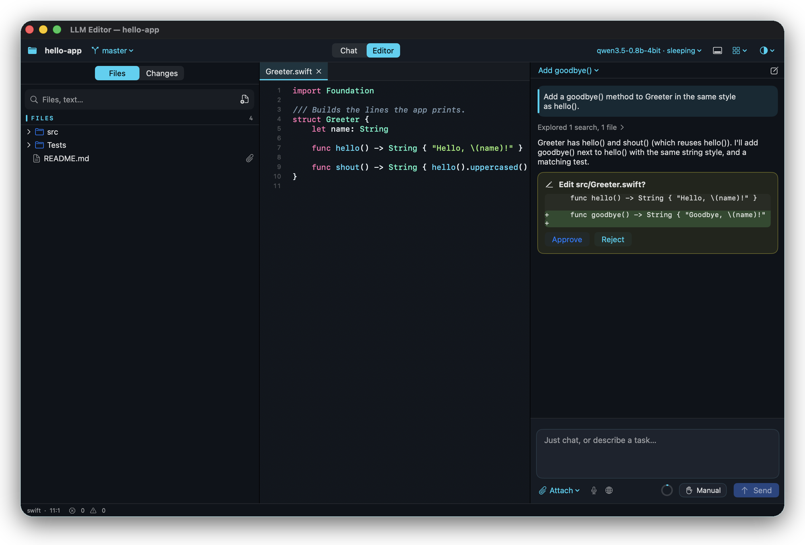
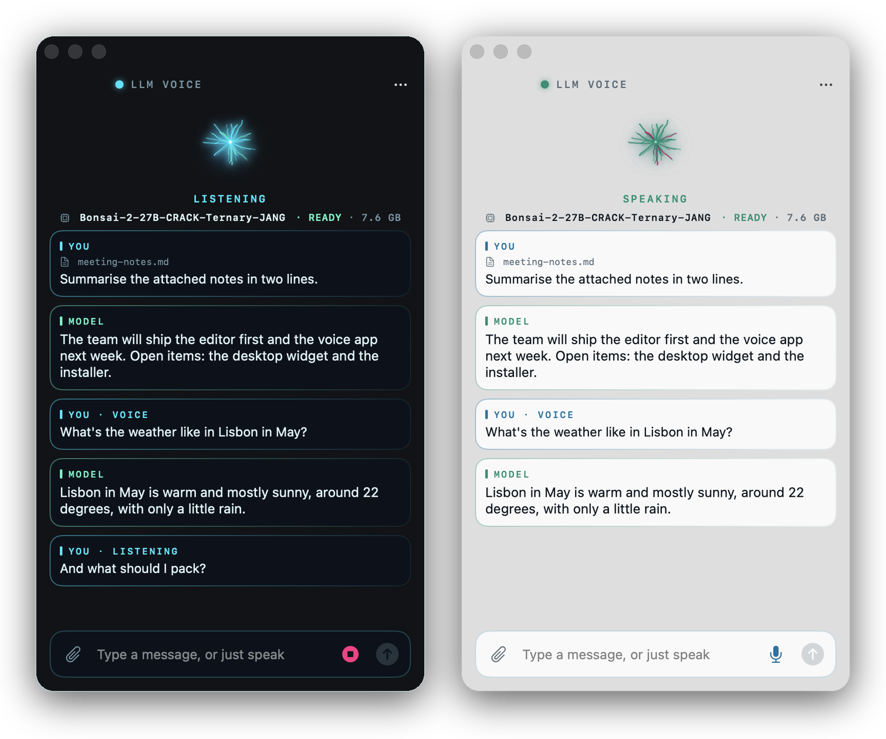

# AI-llm-Engine


A small, dependency-light MLX inference engine for **Qwen3.5-family models** on Apple Silicon. It includes the
**JANG / Prism Hadamard-rotated ternary** bundles that otherwise only run in vMLX, plus a CLI, a menu-bar app
and integrations for Continue, Kilo Code and opencode.

Built and tuned for a **MacBook Air M5, 16 GB** running
[`dealignai/Bonsai-2-27B-CRACK-Ternary-JANG`](https://huggingface.co/dealignai/Bonsai-2-27B-CRACK-Ternary-JANG)
(27B, ~7.6 GB).

[Русская версия](README.ru.md)

<p align="center">
  
  
  
  
</p>

## Why

| Same Mac, same prompts, alternating runs | vMLX 1.6.75 | **llm-engine** |
|---|---|---|
| Decode speed (256 tokens) | 6.80 – 6.94 tok/s | **7.61 – 9.53 tok/s** (+12 – 37 %) |
| Code edits (prompt-lookup speculation) | — | **27 – 35 tok/s** (×2.5 vs plain decode) |
| Prefill speed (2.3K-token prompt) | 73.5 – 88.1 tok/s | **86.7 – 119.5 tok/s** (+18 – 36 %) |
| Cold start to first request | 19 s | **4 s** |
| Process memory on top of the weights | 1.26 GB | **0.66 GB** |
| Install size | 1.9 GB app | **310 MB** venv |
| `max_tokens` above the safe limit | HTTP 413 error | clamped, request succeeds |

The 413 error is what broke Kilo Code with vMLX. Kilo asks for 32,000 output tokens, and vMLX rejects anything above
its Metal headroom estimate (~8.5K on 16 GB).

### What it does that LM Studio, Ollama and plain llama.cpp do not

- **Adaptive Hadamard-rotated quantization (JANG / ternary TQ1).** It runs Prism/JANG Hadamard-rotated affine bundles
  and 1.75-bit ternary formats (TQ1_G128 / PTQ1_0) on its own Metal lookup-table kernel — not only the generic GGUF
  quants the others load. Ordinary GGUF still runs too, on the engine's own MLX decoder (no llama.cpp needed).
- **Fused matmuls through one Hadamard transform.** The bundle stores one sign vector per input width, so q|k|v,
  gate|up and qkv|z each run as a single fused quantized matmul after one shared transform, instead of a transform
  per projection.
- **Compiled layer blocks.** `mx.compile`d blocks (norm→Hadamard, gated-delta pre/post, attention pre/post, MLP +
  residual) cut the thousands of small per-token kernel launches that dominate decode latency — to within ~11 % of
  the raw weight-read time.
- **Exact prompt-lookup speculative decoding.** Code edits, quotes and tool arguments decode ~2.5× faster (27–35 vs
  ~10 tok/s) with output bit-identical to plain greedy; it switches itself off on prose, so nothing is lost.
- **Smart out-of-memory protection.** A whole-machine RAM ceiling (88 % by default) the others do not have: before a
  request it frees caches, caps the output to what fits and refuses an oversized prompt with a clear error — instead
  of swapping and freezing a 16 GB Mac. It shrinks the prefill chunk under pressure and checks every 32 tokens while
  generating. (Where vMLX returns HTTP 413 and fails, this clamps and succeeds.)

Numbers and the full mechanism are in [How it is fast](#how-it-is-fast).

## How it is fast

- **One Hadamard transform per shared input.** The bundle stores one sign vector per input width, not one per
  module. That was verified on load, and a bundle that differs is rejected. So q|k|v, gate|up and qkv|z each run as a
  single fused quantized matmul after one transform, where vMLX does one transform per projection.
- **Compiled layer blocks.** Decode is latency-bound by thousands of small dependent kernels, not only by weight
  bandwidth. `mx.compile`d blocks (norm→Hadamard, gated-delta pre/post, attention pre/post, MLP + residual) bring the
  full decode step to within ~11 % of the raw weight-read time.
- **Pinned weights.** The wired limit keeps the weights resident, so macOS cannot compress or swap them.
- **Hybrid-aware prefix cache.** The GatedDeltaNet state can't be rewound, so the engine snapshots it at the start of
  the generation prompt. An agent that resends the whole conversation only prefills the new tail (310 of 340 tokens
  reused in the tool-call test).
- **Prompt-lookup speculative decoding.** When the output repeats text that is already in the context (code edits,
  quotes, tool arguments), the engine drafts the continuation from an n-gram match and verifies it in one weight
  pass. Small batches are padded to MLX's tiled-matmul size, so verifying 15 drafted tokens costs about five decode
  steps. Acceptance is exact: the greedy output is identical to plain decoding, and sampled output keeps the same
  distribution. The hybrid GatedDeltaNet state rolls back by re-running only the cheap recurrence on the accepted
  tokens. It turns off by itself when nothing matches, so prose runs at plain speed.
- **Adaptive, not tuned to one laptop.** The context length is computed at start from RAM, model size and KV cost
  per token (about 45K on a 16 GB Mac; larger machines reach the model's native limit). The wired limit follows the
  GPU budget of the machine, and the vision tower (~0.5 GB) loads only on the first image request.
- **RAM guard.** The engine keeps the whole Mac under a memory ceiling, 88 % by default (`--mem-limit`, or Settings in
  `./llm`). Above ~90 % a 16 GB Mac starts swapping and freezes. Before a request, the guard checks the headroom and
  frees caches; it caps the output to what fits and refuses an oversized prompt with a clear error. During prefill it
  shrinks the chunk size (1024 → 256 → 128), and during generation it checks every 32 tokens. Peak memory while
  loading equals the weights (was +1.7 GB).
- **Last-position logits only** during prefill, chunked prefill, GPU-side top-k/top-p/min-p sampling and a pipelined
  (`async_eval`) decode loop.

A note on numbers: a fanless MacBook Air lowers GPU/memory clocks after a few seconds of full-bandwidth load. The raw
weight-read time goes from ~60 ms to ~95–120 ms per token regardless of engine, so expect 7–10 tok/s sustained on
this 27B model.

## Quick start

```sh
./llm setup        # creates .venv (mlx, tokenizers, jinja2, numpy, pillow)
./llm models       # lists models found in ~/.cache/huggingface/hub
./llm use 1        # select one
./llm open         # new Terminal window: starts the model and opens a chat
```

Double-clicking **`LLM.command`** in Finder does the same as `./llm open`. `./llm setup` is actually optional —
`start`/`open`/LLMBar's Start button create the `.venv` and install `requirements.txt` on first use anyway; the only
thing you need already on the Mac is nothing: when there is no Python 3.10+ (or only an outdated one) a private
CPython (~35 MB, checksum-verified) is downloaded into the data folder first. `./llm check` reports in a second
whether everything is there — Apple Silicon and macOS, Python, the engine libraries, the network (only when
something must be downloaded), free disk, models — and LLMBar shows the same as a banner with *Check again*; a
missing connection is named as such. For a Mac that will never see the internet,
`./build-app.sh --offline` / `./build-dmg.sh --offline` put Python and the libraries' wheels inside the app (+~150 MB).

### Models: search, download, switch

```sh
./llm search qwen3.5            # MLX models on Hugging Face: size, downloads, "engine ✓", fits RAM
./llm pull mlx-community/Qwen3.5-4B-MLX-4bit   # resumable download into ~/.cache/huggingface/hub
./llm fetch https://host/model.gguf            # a source you provide: a .gguf/archive URL, or a magnet (needs aria2c)
./llm run mlx-community/Qwen3.5-4B-MLX-4bit    # Ollama-style: download if needed, start, then chat
./llm run qwen3.5 "two plus two?"              # already installed: one answer and exit
./llm show qwen3.5               # a quick card: format, route, size, context, capabilities
./llm ps                         # the model loaded right now
./llm create coder --from qwen3.5 --system "You are a terse senior engineer." --param temperature=0.2
./llm run coder                  # a named profile: its base model, system prompt and sampling
./llm use 2                      # switch the active model (restarts the engine if it runs)
./llm fav 2                      # star a model (again: unstar) — favourites lead every list and model menu; ./llm fav lists them
```

Downloads resume if interrupted, check free disk space first and skip weights the engine does not use. Set
`HF_ENDPOINT` to use a mirror (e.g. `https://hf-mirror.com`) and `HF_TOKEN` for gated repos. **ModelScope** is a
second source: `./llm search qwen3 --source modelscope` and `./llm pull ms:mlx-community/Qwen3-0.6B-4bit` (the same
folder layout and checks; the Hugging Face token is never sent there; a switch in LLMBar's models tab). Both JANG bundles and
regular mlx-community / lmstudio-community conversions of the dense Qwen3.5 family run on the engine, including tied
embeddings and quantized gate projections.

### GGUF models

GGUF is what Hugging Face, LM Studio and Ollama hand out, and it runs here too — `./llm models` lists the files in your
model folders, in LM Studio's folder and in Ollama's store (read in place, never copied), and
`./llm pull org/name:Q4_K_M` fetches one quantization of a repo (`ms:` for ModelScope).

- **Own decoder (no llama.cpp).** A file whose architecture, quantization and tokenizer the engine implements runs on
  its own MLX decoder: llama and Qwen2/Qwen3 families (Llama 3.x, Mistral, SmolLM2, DeepSeek-R1-Distill-Qwen, Qwen2.5…),
  **Gemma 2** (soft-capped attention and logits, sliding window on every other layer) and **Gemma 3**
  (sliding-window layers, two rope bases, GeGLU), **Granite** and **MiniCPM** (with LongRoPE), and
  **mixture-of-experts** files (Mixtral-style, Qwen3-MoE, Granite-MoE: experts stay stacked and quantized, a token
  runs only its top-k with `gather_qmm`). Quantizations `Q4_0 Q4_1 Q5_0 Q5_1 Q8_0 Q4_K Q5_K Q6_K F16 BF16 F32` plus
  `Q2_K Q3_K IQ4_NL IQ4_XS`; vocabularies are byte-level BPE or SentencePiece (incl. the dummy space prefix). The
  weights are repacked into MLX's affine quantization when loaded (Q4/Q5/Q8 exactly; Q6_K into 8 bits; Q2_K, Q3_K and
  the IQ4 types are decoded exactly — checked tensor by tensor against llama.cpp's own dequantization — then
  re-quantized per 32 weights to 4 / 5 / 6 bits, so they take more memory than in the file), the tokenizer and the
  chat template are built from the file's own metadata, and it shares the server, the prompt cache, the stop handling,
  the reasoning budget, the memory watchdog and prompt-lookup speculation with the other routes.
- **llama.cpp for the rest.** Any other GGUF (other architectures, IQ1–IQ3 quantizations, MoE with per-expert tensors
  or a shared expert, files with an image projector) goes to llama.cpp's `llama-server` behind the same API. It is
  downloaded only when such a file is chosen (`./llm setup --gguf`); with `gguf_native` off every GGUF uses it.
- **Export to MLX.** `./llm convert <model.gguf> [out]` writes a GGUF as a plain MLX folder — `config.json`, a
  float16 `model.safetensors` (dequantized by the decoder's own unpacking, so the values match what the engine
  runs) and a `tokenizer.json` rebuilt from the file's vocabulary — so a converted model opens with mlx-lm without
  the GGUF around. llama / Qwen2 / Qwen3 for now.
- **How close.** Against llama.cpp on the same files (logits on 11 prompts, 24-token greedy continuation): Qwen2.5 0.5B
  and 3B, DeepSeek-R1-Distill-Qwen 1.5B and SmolLM2 135M agree on the top token on every prompt (log-probabilities
  within 0.02–0.08) and on 24 of 24 greedy tokens; Llama 3.2 1B agrees on 10 of 11 prompts (≤ 0.18). Gemma 3 1B,
  Granite-MoE 1B-A400M and MiniCPM4 0.5B give token ids identical to llama.cpp on every test string (English,
  Russian, CJK, code, emoji, special tokens), the same top token everywhere and the same 32 greedy tokens on most
  prompts (a few differ at near-tied tokens, log-probabilities within ~0.3). Activations are kept in float32
  between layers, as ggml does.
- **How fast** (M5 MacBook Air, 16 GB, Q4_K_M, a busy machine so ±10 %): small models decode on par with llama.cpp
  (Qwen2.5 0.5B ~190–210 tok/s); on a 3B model the engine is ~13 % behind (22 ms against 19.5 ms per token — MLX's
  4-bit format spends 5 bits per Q4_K weight where Q4_K spends 4.5). Rewriting a file, where the answer copies the
  prompt, runs at ~145 tok/s against 46 without speculation (×3.2); llama.cpp's own `ngram-mod` is faster on pure
  copying (~600 tok/s), without it llama.cpp does ~55.

### Sleep and the SSD prefix cache

- **Auto-sleep.** After 15 idle minutes (configurable, 0 = never) the engine unloads the weights and gives about 7 GB
  back to macOS. The next request wakes it in about 2 s.
- **SSD prefix cache.** The KV and recurrent state at two restore points per request (the end of the system prompt and
  the start of the answer) is written to `~/.cache/ai-llm-engine/prefix/` (configurable) when the model goes to sleep
  or the server shuts down cleanly — not after every single message, since a growing conversation's snapshot point is
  different every turn and writing the whole thing to disk each time would be wasteful SSD wear for a cache that's
  only a speed optimization. The budget is 8 GB by default (set it to `"auto"` for 10% of free disk space, or 0 to
  turn the cache off), and the least recently used entries go first. A long
  agent system prompt is prefilled once and then restored from disk across sleeps, restarts and model switches, with
  output identical to a cold run.

### Menu-bar app (optional)

```sh
./build-app.sh && open LLMBar.app      # ONE app: panel + editor + voice chat + widget (engine + CLI bundled)
./build-dmg.sh                         # docs/LLMBar-1.0.dmg — drag-to-Applications installer
```

LLMBar is the lightweight UI of the engine. It lives in the menu bar as a small `Ai_` icon. Click the icon to open a
frosted-glass panel right under it; click again, press Esc or click elsewhere to hide it (the model keeps running).
Double-clicking the app opens the same panel. If the icon is hidden behind the notch or another app's menus, ⌘-drag it
closer to the clock; its position is remembered. The panel follows a dark or light theme. It has five tabs:

- **Engine:** status, last-request speeds, the RAM guard meter, a token ledger for the session and all time (cache
  hits, averages, history chart), and a **memory card**. The card is one bar for the whole Mac: model weights, context
  (KV cache), recurrent state with prefix snapshots, engine buffers, the engine process, other apps and free memory,
  with the RAM-guard limit marked.
- **Monitor:** E- and P-core load, thermal state, GPU load and memory, and the memory breakdown, each with graphs.
- **Models:** installed models with one-click switching, plus hub search and download with progress.
- **Settings:** context, output, reasoning, images, speculation, RAM limit, sleep, SSD cache, port, LAN, API key,
  language and theme. An Advanced section holds sampling, draft length, n-gram, MLX cache, prefill chunk and image
  size. Every setting has a hint.
- **Tools:** chat, coding agent, connecting an editor, logs, tests and benchmarks.

<p align="center">
  
  
  
</p>

It polls only while the panel is open and does all its work through `./llm`. Built from a checkout, it uses that checkout. Installed
from the DMG on another Mac, it runs its bundled copy and keeps its config and `.venv` in
`~/Library/Application Support/LLMBar`. On the first Start it creates them, which needs Python 3.10+ and internet.

## CLI

```
./llm                      interactive menu
./llm open | up            new window with chat | start + chat + menu in this terminal
./llm start|stop|restart|status|chat|bench|logs
./llm service install      optional background service (launchd): the API is up after login, restarts on a crash
./llm update [--check]     is there a newer release on GitHub? (--check reports; else downloads & opens the .dmg)
./llm models | use <n>     discover / select models
./llm check [--json]       is everything there to run the engine? (Python, libraries, network, disk, models)
./llm web search "<q>"     web search + the top pages as one JSON line (what the voice chat uses)
./llm inspect [<#|name>]   what is inside a model, from its headers: layers, storage types, bits per weight, biggest tensors
./llm agent [dir]          terminal coding agent (files, search, edits, shell)
./llm connect [client]     register the model in Continue, Kilo Code or opencode
./llm free                 quit vMLX / oMLX / Ollama to free memory
./llm steer [repo|folder]   apply an activation edit (and fetch its base model) · `steer off`
./llm test                 unit + integration tests
./llm perf [--save]        performance suite vs the saved baseline
./llm eval [--save]        accuracy suite (math / code / sanity) vs the saved baseline
./llm calibrate [--apply]  find the largest context that actually prefills on this Mac
```

Language is English by default and Russian when the system locale is Russian. You can force it with `LLM_LANG=ru` or
in Settings.

`./llm chat` keeps its history **per project in the same file the code editor uses**: `/history` lists the chats,
`/open <N>` continues one (also one started in the editor), `/rename <N> <title>`, `/delete <N>`, `/new`.

## API

OpenAI-compatible on `http://localhost:8090/v1`:

- `POST /v1/chat/completions` supports streaming, `reasoning_content`, tool calls (the model's XML format is converted
  to OpenAI `tool_calls`) and images (`image_url` with a data URI, http URL or file path).
- Thinking is controlled with `chat_template_kwargs.enable_thinking`, `reasoning_effort` (`low`, `medium`, `high`→`xhigh`)
  or `thinking: {type: "disabled"}`. When a request doesn't say, the model gets **its own template's default**
  (`--thinking auto`): on for Bonsai-27B, off for the small Qwen3.5 models, whose authors ship them with reasoning
  disabled — forcing it on is what makes a 0.8B write hundreds of tokens of "Thinking Process" before answering
  7 + 5. Models without a reasoning mode or a vision tower simply ignore those options (an image gets a clear 400).
- Sampling comes from the bundle (`jang_config` modes, else `generation_config.json`), and for a bundle that ships
  neither, from the Qwen3.5 family presets (temperature 1.0 / top-p 0.95 / top-k 20 when reasoning, 0.7 / 0.8 / 20
  with presence penalty 1.5 otherwise) — never "temperature 1.0 over the whole vocabulary", which sends a small model
  rambling. A runaway reasoning phase is cut off by a token budget (`--think-frac`) or by detecting a repeating loop,
  and the answer is then produced from the closed reasoning; `think_forced` in a request's stats says if that happened.
- `GET /v1/models`, `GET /health` (state, memory breakdown, cache, last request speed) and `GET /v1/stats` (token
  statistics for the session, all time and recent requests).
- The memory breakdown is also printed by `./llm status`. The engine's own footprint is measured like Activity
  Monitor does (`phys_footprint`, which includes Metal memory that RSS misses).

The **Ollama API** is served from the same port, so a tool that speaks to Ollama needs no adapter — point it at
`http://localhost:8090`: `POST /api/chat` and `POST /api/generate` (streaming NDJSON or one object; `options`,
`tools`, `images` and `think` are translated), and `GET /api/tags`, `POST /api/show`, `GET /api/ps`, `GET /api/version`.
It is the same loaded model and the same generation path as the OpenAI route.

The **Anthropic Messages API** is native, not a wrapper: `POST /v1/messages` (streaming SSE —
`message_start` → `content_block_*` → `message_delta` → `message_stop` — or one message object) with `system`,
`stop_sequences`, `tools` (`input_schema`), `tool_use`/`tool_result` and `thinking` translated to the engine, and
the reply returned as Anthropic `thinking`/`text`/`tool_use` content blocks. Auth takes `x-api-key` as well as
`Authorization: Bearer`. The same loaded model, again on the one generation path.

Any `model` name is accepted, since the server hosts exactly one model.

`POST /v1/chat/completions` also takes `repetition_penalty` (1.0 = off; 1.05–1.2 divides the score of tokens
already written — `presence_penalty` alone cannot break a closed cycle), and an answer that visibly loops (the same
chunk repeated back to back) is cut off by the engine itself instead of running to the token limit.

Engine switches (also in LLMBar's settings): `--log-level error|warning|info|debug|trace` (every line is tagged
`[request]`, `[memory]`, `[model]`, `[cache]`, `[sleep]`, `[quality]` or `[error]`), `--fallback-model off` (a request
naming another model gets `404 model_not_found` instead of being answered by the loaded one),
`--prefill-guard off` (skip the memory pre-check of long prompts). `GET /health` reports `progress` while a long
prompt is prefilled — a 20k-token agent prompt takes minutes on a 27B model, and LLMBar shows it. Proxy settings
(`proxy_http`, `proxy_https`, `no_proxy`, `ca_bundle`) become the variables `urllib` and `ssl` read, so downloads,
hub search and the agent's web tools follow them; the engine on this Mac is never proxied.

### Images from text (optional module)

`./llm setup --images` installs [mflux](https://github.com/mflux-community/mflux) (FLUX and others on MLX) into its own
environment, `./llm image "a lighthouse at dusk"` writes a PNG, and with the engine started `--images on` (or the
*Image API* switch) `POST /v1/images/generations` answers with a base64 PNG. The language model is unloaded while an
image is made, so the two never share memory.

### Activation edits (optional)

Some repositories ship an *edit* instead of weights: one direction in the model's hidden space and a strength, for
example [`rariruluis/ternary-bonsai-2-27b-mlx-runtime-abliterated`](https://huggingface.co/rariruluis/ternary-bonsai-2-27b-mlx-runtime-abliterated).
`./llm steer <repo|folder> [--alpha A]` downloads it **and the base model it was made for** (the exact revision it
names, when that model is not installed), selects that model and applies the edit at inference:
`y -= α · (y·d) · d` on what every layer writes into the residual stream, accumulated in float32. The quantized weights
stay as they are; α = 0 is the unmodified model. It is per model, works on the native routes (the Qwen3.5 hybrid and
the own GGUF decoder), `./llm steer off` removes it, `/health` shows `steer`, and a direction of the wrong size is
refused at start (it belongs to one model). The SSD prefix cache of a steered model is kept separate. A research and
red-teaming tool for models you own.

### Coding agent

`./llm agent [folder]` is a terminal coding agent that needs only this engine, with no VS Code and no Kilo. It can list,
read and search files, write files, make exact edits and run shell commands, all scoped to the folder. Writes, edits
and commands show a diff or the command line and ask first; `/auto` approves them for the session. It speaks the
user's language.

Optional extras, each off until you ask (nothing is contacted or added to the prompt by default):

| Command | What it does |
|---|---|
| `/web on` | `web_search` and `web_fetch`: search the internet (DuckDuckGo, no key; `LLM_SEARCH_URL` for a SearxNG) and read pages as clean text. Private/LAN addresses are refused; one question per session before anything goes out. |
| `/mcp add context7`, `/mcp on` | MCP servers from `.llm/mcp.json` (stdio or HTTP): Context7 for current library docs, [Stitch](https://stitch.withgoogle.com/) for UI designs (`/mcp add stitch`, key in `STITCH_API_KEY`). Switch whole servers or single tools; `/mcp` shows status and what the tool definitions cost per request. |
| `/workers add openrouter`, `/workers on` | `delegate`: hand a self-contained sub-task to another model — any OpenAI-compatible endpoint (OpenAI, Anthropic, Gemini, a second local engine) or a CLI agent — configured in `.llm/workers.json`. Keys come from environment variables; the worker sees only the task and the files you approve, and each hand-off asks first. |
| `/fix-tests [command]` | Runs the tests, gives the model only the failing tests with tracebacks, lets it edit (each edit still asks), re-runs. Stops on green, after 5 rounds, or when two attempts change nothing. |
| `/memory`, `/remember <note>` | Standing project instructions from `.llm/memory.md`, `AGENTS.md` or `CLAUDE.md`. |
| automatic | `.llm/map.md` — a model-free map of the project (rebuilt only when files change) and `.llm/session.md` — the agent's own notes, saved on exit and read at start, so a restart does not re-scan the project. `/map` and `/save` do it on demand. |
| `/compact` | Long sessions are compacted automatically at 70% of the context window; this does it now. |

A `.llm/mcp.json` or `.llm/workers.json` that came **with the project** is shown first (the programs it would run, the
addresses, the environment variables that go into requests) and needs a yes — once per file content, even in `/auto`.
Your own `~/.llm/` configs are not asked about.

### Code editor (optional, native)

The editor is a **module of the one LLMBar app** (`./build-app.sh` builds it; there is no separate editor app). LLMBar's
`</>` button (header) and the *Code editor* tool open it, each time in a new window; `./llm ui [folder]` does the same
from the terminal (it sends the `llmbar://editor?root=…` link). Nothing of it is created until the first window, it can be
switched off as a whole in LLMBar's settings (*Code editor module*), and its own parts are modules too (Files, Outline,
Changes/git, Assistant, Problems, Terminal). Its theme is LLMBar's theme, one setting for everything:

- **Two layouts:** chat-first (chats, the conversation with *Explored…* activity, questions with options, approvals,
  files on the right) and a classic editor (file tree, tabs, outline, assistant). Switch with ⌘E.
- **Assistant:** an agent that searches and reads the project, asks you when something is ambiguous, and edits or runs
  commands only after your approval (a diff or the command is shown first). Attach files to a message with 📎.
- **Modes** (the button left of the message box, Shift+Tab cycles): *Manual* asks before every edit and command;
  *Edit automatically* applies file edits right away and still asks for commands; *Plan* explores the project and
  presents a plan without changing anything; *Auto* also runs commands that pass a safety check (no chaining, no
  paths outside the project, no destructive git forms) and pauses for anything else. **Effort** is the model's
  reasoning level (off, then the levels its template offers).
- **Context:** a ring shows how much of the model's window the conversation fills; **Compact** folds older turns into
  a short note (the same two-stage compaction as the terminal agent). Chats are renamed and deleted from the ⋯ menu.
- **Editor:** syntax colours and an outline for ~40 languages, line numbers, problems underlined as you type
  (built-in checks, plus `swiftc -parse`, `node --check`, `bash -n` … when installed), unsaved-changes protection.
- **Problems and terminal:** ⌘J. Send a problem, or terminal output, to the assistant with one click. Several
  terminals (a plus in the strip, each its own shell). Type errors from `mypy` (Python) and `tsc` (TypeScript) join the
  problems when those tools are installed.
- **Command palette:** ⇧⌘P — a few letters find any command of the File and View menus (the list is the menus).
- **Large files:** over 2 MB a file opens as a read-only head of 256 KB (and is never saved from the editor).
- **Git:** changes, diff, commit selected files, push (always asks first; it uses your own git credentials). ↶ on a
  file (or *Discard all*) puts it back to the last commit and deletes new files — after a confirmation that says what
  is lost. The branch menu in the toolbar switches or creates branches. **GitHub** (through the `gh` tool): sign-in check, open
  pull requests, create a pull request or a repository — both ask first.
- **Message box:** Enter sends, Shift+Enter starts a new line; attach files from anywhere (or paste/drag them), images
  (switch *Images* on for a model with a vision tower — it restarts the model) and **dictate** with the microphone
  button (the system speech recogniser, on-device when the language supports it).
- **Model:** the toolbar menu starts and stops the model and switches between the installed ones (the same
  `./llm start|stop|use`).
- **Web:** the globe button (off by default) lets the assistant search the internet and read pages; every request is
  shown in the conversation.
- **Pictures:** with the engine started `--images on` the assistant can draw (`generate_image`); the picture appears in
  the message and is saved under `.llm/images/`.
- **Assistant tools (MCP)** (opt-in module, *Assistant Tools (MCP)* in the Modules menu): connect MCP servers so the
  assistant can use their tools on the open project. A small catalog (context7, Stitch) and your own servers — a
  program over stdio (`command`/`args`) or a streamable-HTTP URL. The tools run with the project as their working
  directory, so they act on this code; every call asks for your approval, and a server is contacted only when you
  press *Test* or the assistant uses it. The servers live in the workspace `.llm/mcp.json`, trusted per content.
- **Model source:** the assistant can use another OpenAI-compatible server — another computer running this engine
  (`https://…/v1`, an API key), OpenRouter — from the toolbar menu. The key is kept in the Keychain; messages and
  attached files go to that server, which is why it asks.
- **Preview** (opt-in module): a browser pane for the page you are editing — a project `.html` file reloads when you
  save, or any `http://localhost:…` dev server.
- **Look:** System / Light / Dark with a palette in the family of LLMBar's (opaque, for reading).

The editor talks to a small local backend (`ui/server.py`, stdlib only, localhost + a random token, paths confined to
the project) that the app starts and stops itself.

### LLM Voice (optional, native)

A **module of the same LLMBar app**: a quick chat that works as a voice assistant by default — it listens when it
opens, you speak, it answers short and aloud; or type, and attach files and pictures to a message (text files are sent
with it, pictures go as image parts and are dropped with a note if the model has no vision). Its window exists only
while you use it: LLMBar's header and tool row have a button for it, it can be switched off in the settings (*Voice chat
module*), and it follows LLMBar's light / dark theme. Speech goes through the system recogniser (on-device when the language
supports it), spoken answers use the system voice; the model is the engine's usual one — the app starts the selected
model (or the first installed one that fits) through the same `llm` command when none is running. It is an ordinary
window — close and minimise buttons, resizable, *Keep on top* in its menu — in LLMBar's glass style (light, dark or
system, with the same transparency setting), and it reads LLMBar's settings (`.llm/config.json`). Under the sphere it
shows which model is selected and its state (ready / asleep / not running); while the weights are read into memory
there is a progress bar with the bytes the engine process holds so far, and a sleeping engine is woken on open. The first run asks for the microphone and speech-recognition permissions.

- **Dialog mode** (menu, on by default): after each answer the microphone opens again by itself, so a conversation
  needs no button presses; it ends on a long silence, a click on the sphere while nothing is said, or a typed message.
- **The whole conversation** goes with every question (oldest turns dropped only past a budget), so follow-ups
  ("and its population?") refer to what was just said.
- **The web** (menu, on by default): a question about news, weather, prices, scores or "today" is looked up — the
  model proposes a query, with keyword cues in five languages when a small model stays silent, `llm web search`
  fetches the results and the top pages, and the answer is built from them; a failed lookup is said honestly. Only the
  search query leaves the Mac (to DuckDuckGo).
- **History:** a clock button at the top left opens saved conversations — open, rename, delete; the model menu under
  the sphere is always there (favourites, any installed model).

**Desktop widget** (macOS 14+): the app carries a WidgetKit extension in two sizes. The small one is the orb: a click
opens the chat, the app starts the model and listens at once. The wide one shows the selected model and whether it is
up, a large sphere (a click opens the voice chat) with **GPU load on one side and RAM use on the other while the model
is on** (a snapshot refreshed every couple of minutes, as often as the system's widget budget allows). While the model is on
the sphere moves at a very low frame rate (a frame every ten seconds, prepared in advance — a widget cannot run a
continuous animation); when the model sleeps or is off it stands still and the dot is an empty ring, a power button that turns the model on or off **in the
background** (the already running app runs `llm start` / `llm stop`; no window), and three icons — voice assistant,
editor, terminal CLI — each of which starts loading the model ahead of use, so it is ready when the window is. The
widget's taps are `llmbar://` links into the one app. WidgetKit lists extensions only of apps that live in
`/Applications`, so `./build-app.sh --install` builds the app, copies it there and registers the widget; then
right-click the desktop → *Edit Widgets* → *LLMBar*. It is signed ad hoc (no developer account), so it works on
the Mac that built it.

### Benchmarks

`./llm eval` has two modes. Without arguments it runs the small built-in regression suite (math, code, sanity).
With `--suite` it runs standard benchmarks zero-shot through the model's chat template, on a seeded random subset:

```sh
./llm eval --suite list
./llm eval --suite gsm8k,mmlu,arc,hellaswag --limit 100
./llm eval --suite humaneval,mbpp --allow-code     # executes the model's code locally
./llm eval --suite mmlu --limit 0                  # 0 = the full dataset
```

GSM8K, MathQA, MMLU, MMLU-Pro, ARC-Challenge, HellaSwag, TruthfulQA (MC1), WinoGrande, KMMLU (Korean), C-Eval (Chinese),
BBQ, SafetyBench (dev, 35 questions: the test answers are withheld), HumanEval and MBPP are supported (HumanEval/MBPP
code runs in a macOS sandbox without network and without writes outside a throw-away folder);
datasets come from the Hugging Face datasets server and are cached. The score is generative zero-shot accuracy with a
95 % interval, so it is comparable between models and between runs of this tool, not with published
log-likelihood or few-shot numbers. Stop the engine first.

### Editors: Continue, Kilo Code, opencode

Nothing is tied to one editor. Run `./llm connect` and pick one, or name it directly:

```sh
./llm connect continue   # ~/.continue/config.yaml — adds a managed block, keeps your other models
./llm connect kilo       # ~/.config/kilo/kilo.jsonc
./llm connect opencode   # ~/.config/opencode/opencode.json
```

Each one gets the engine URL, tool and image capabilities, and the context and output limits of the running engine,
and **every installed model** is registered (under the id it is served as and the older `org/name` id), so the
client's model picker sees what is on disk; the entry is refreshed whenever the engine starts or a model is selected.
A `.bak` copy is kept, and running it again only updates its own entry. Any other OpenAI-compatible client works with
`http://localhost:8090/v1`.

## Run the engine directly

```sh
.venv/bin/python -m engine.server --model <path> --port 8090 \
    --context 32768 --max-tokens 8192 --thinking auto --effort medium [--no-vision]
```

## Tests

```sh
./llm test
# or: ENGINE_TEST_MODEL=<model path> .venv/bin/python -m unittest discover -s tests -v
```

There are 43 unit tests (engine, CLI and the coding agent): Hadamard against an explicit matrix, fused vs separate
projections, caches, M-RoPE, the sampler, the drafter, speculative acceptance (it keeps the sampling distribution),
SSM rollback (equal to sequential), the reasoning/tool-call stream parser, message normalization, the repetition
detector, the RAM-guard grace band, and which shell commands the coding agent always confirms. There are also 9
integration tests on the real model: a correct answer, UTF-8 streaming detokenization, bit-exact prefix-cache reuse,
speculative greedy identical to plain greedy, the RAM guard refusing instead of swapping, the SSD prefix cache
surviving a restart with identical output, sleep and wake, `max_tokens` clamping, and the think-budget guard forcing
an answer instead of an endless `<think>`.

### Performance and accuracy suites

```sh
./llm perf            # speed: compare with tests/perf_baseline.json; exits 1 on >15 % regressions
./llm perf --save     # record a new baseline after an intentional change
./llm eval            # quality: compare with tests/eval_baseline.json
./llm eval --save
```

`perf` measures load time, decode step, the cost of a 16-token verify pass, prefill at three prompt sizes, prose and
code-edit speed, draft acceptance, peak memory and peak system RAM. `eval` complements it with a quality check — math
word problems, function-completion problems graded by actually running the generated code, and trivial sanity
questions that must finish cleanly rather than loop — so a change that quietly breaks answers gets caught, not just
one that slows them down. It runs each model in its own default reasoning mode with the model's sampling presets and a fixed seed (`--think on|off` and `--greedy` change that — reasoning models loop under greedy decoding, so a greedy benchmark mostly measures the loops) and reports how many replies had their reasoning force-closed or hit the token limit. Both accept a repeated `--model PATH` to compare several models in one run. Stop the
server first. If memory runs short, a metric is skipped instead of freezing the Mac.

`./llm calibrate [--apply]` checks the auto-context formula (RAM × limit − weights, divided by KV cost per token)
against reality instead of only trusting the math: it binary-searches real prefill attempts, each in its own fresh
subprocess so a hard crash at one size only rules out that size. `--apply` writes the result as the model's context
(no longer `auto`) once it's confirmed to actually fit, not just computed to.

## Supported models

`./llm models` shows the route of every model it finds:

| Route | What | State |
|---|---|---|
| native | the Qwen3.5 hybrid (GatedDeltaNet + attention, dense) — recognised by the config's architecture fields, not by a list of names — any MLX quantization, JANG / Prism Hadamard bundles, vision | the engine's own code |
| 1.75-bit (experimental) | PTQ1_0, TQ1_G128 (inductiveML "ternel") and JANG packed ternary bundles, on one Metal lookup-table kernel | enabled by choosing such a model |
| mlx-lm | everything else MLX (Qwen2/3, GLM, Llama, Gemma, MoE…), text only | optional: `./llm setup --compat` |
| GGUF, own decoder | llama / Qwen2 / Qwen3 / Gemma 2 / Gemma 3 / Granite / MiniCPM and MoE files, `Q2_K…Q8_0`, `IQ4_NL/IQ4_XS`, F16, BPE or SentencePiece | the engine's own code, no llama.cpp |
| GGUF, llama.cpp | every other GGUF (other architectures, IQ1–IQ3, per-expert MoE, image projectors) | downloaded on demand: `./llm setup --gguf` |

What each route can do (also printed under every model by `./llm models` and in the panel's tooltip):

| Route | vision | thinking | tools | SSD prefix cache | speculation | activation edits |
|---|---|---|---|---|---|---|
| native | ✓ (with a vision tower) | ✓ | ✓ | ✓ | ✓ | ✓ |
| 1.75-bit | ✓ (JANG) | ✓ | ✓ | ✓ | — (a pass of 2–16 rows costs ~6 steps) | — |
| GGUF, own decoder | — (an image projector sends it to llama.cpp) | ✓ | when the template speaks `<tool_call>` | — | ✓ | ✓ |
| GGUF, llama.cpp | ✓ (with a projector) | ✓ | ✓ | — | its own `ngram-mod` | — |
| mlx-lm | — | ✓ | when the template speaks tools | — | — | — |

Not supported: non-MLX, non-GGUF weights, 1-bit affine JANG. Speculative decoding with a trained drafter (DFlash,
DSpark) is not implemented: measured, the vendor's own numbers say it does not pay on Apple Silicon (≈1.2× at best on
an M5 Max, slower for the 1-bit model), and the published Q4_1 drafter needs the vendor's fork to load; the engine
uses prompt-lookup speculation.

## Changes

See [CHANGELOG.md](CHANGELOG.md) ([по-русски](CHANGELOG.ru.md)).

## Layout

```
engine/   model.py (layers, Hadamard, fused ops) · loader.py · vision.py · gated_delta.py
          tokenizer.py · generate.py (cache, sampling) · server.py (HTTP) · steering.py (activation edits)
          gguf.py · gguf_tensors.py · gguf_tokenizer.py · dense.py · gguf_engine.py (own GGUF decoder)
          gguf_server.py (llama.cpp behind the same API)
llm.py    CLI / menu (stdlib only) — locales/ru.json for Russian
agent.py  terminal coding agent (stdlib only) · harness/ optional web / MCP / memory / compaction / fix-tests modules
app/      LLMBar.swift (menu-bar app) · editor/ (LLM Editor) · voice/ (LLM Voice)
tools/    icon / DMG background / banner generators (Swift)
build-app.sh (one app: panel + editor + voice + widget), build-dmg.sh
tests/    unittest suite · perf.py + perf_baseline.json · eval.py + eval_baseline.json
```

## License

Apache-2.0 — see [LICENSE](LICENSE). Parts are derived from vMLX and jang (Apache-2.0), and from mlx-lm and mlx-vlm
(MIT). See [NOTICE](NOTICE) and `third_party/`. Model weights are not included and have their own licenses.
