# AI-llm-Engine

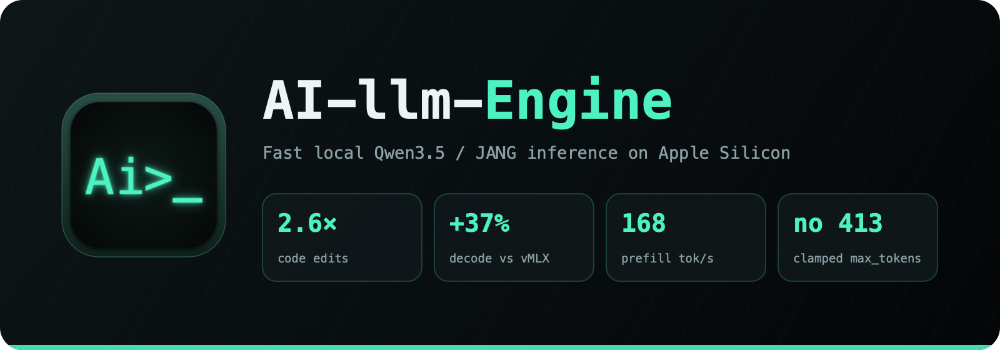

**Private AI for your whole Mac — chat, voice, code and your browser, on one local model.** No cloud, no
subscription, no account: download a model once and it works offline, with nothing ever leaving the machine.

**[⬇ Download LLMBar.dmg](https://github.com/dsavenk0/AI-llm-Engine/releases/latest/download/LLMBar.dmg)**

> **First launch on macOS:** the current download is not signed with an Apple Developer ID and is not notarized,
> so Gatekeeper blocks it once. Try to open LLMBar, press **Done**, then open **System Settings ▸ Privacy &
> Security**, scroll to the security message about LLMBar, press **Open Anyway** and confirm. Later launches open
> normally.

## What sets it apart

- **🌐 A browser agent that never phones home.** In Safari, Firefox and Chromium it can read the page, answer
  questions, fill forms and carry out multi-step tasks. It uses the DOM when possible, vision when necessary, and
  asks before sending, buying, deleting or overwriting anything.
- **🧠 Local models without the usual limits.** Run MLX and GGUF models, including models larger than available RAM.
  LLMBar checks compatibility and memory before a download, then chooses the best available engine automatically.
- **🛡 Built for everyday Macs.** System-wide memory protection keeps a 16 GB Mac responsive, even while several
  apps share the model.
- **⚡ Fast on Apple Silicon.** Native Metal execution, prompt caching and speculative generation make local chat
  and code editing feel immediate. In the measured 27B JANG comparison, the engine was ready in about **4 seconds**.
- **🎙 Voice, files and images.** Talk naturally, switch languages, search the web when you choose, and understand
  PDFs, scans, photos and voice memos on the Mac itself.
- **🔌 One private API for your tools.** Connect Continue, Kilo Code, opencode, Cline or another OpenAI-, Ollama- or
  Anthropic-compatible client to the same local engine.

### Measured against another local runner

Same 27B JANG model, Apple M5 with 16 GB, sequential runs in October 2026:

| | LLMBar engine | vMLX 1.6.75 |
|---|---:|---:|
| Cold start to first request | **4 s** | 19 s |
| Text generation | **7.61–9.53 tok/s** | 6.80–6.94 tok/s |
| 2.3K-token prefill | **86.7–119.5 tok/s** | 73.5–88.1 tok/s |
| Process memory beyond weights | **0.66 GB** | 1.26 GB |
| Installed runtime | **310 MB** | 1.9 GB |

These are dated measurements on one model, not a promise for every checkpoint. The [developer guide](docs/DEVELOPER_GUIDE.md)
contains the conditions, newer small-model results and the architectural comparison with Ollama, LM Studio and llama.cpp.

  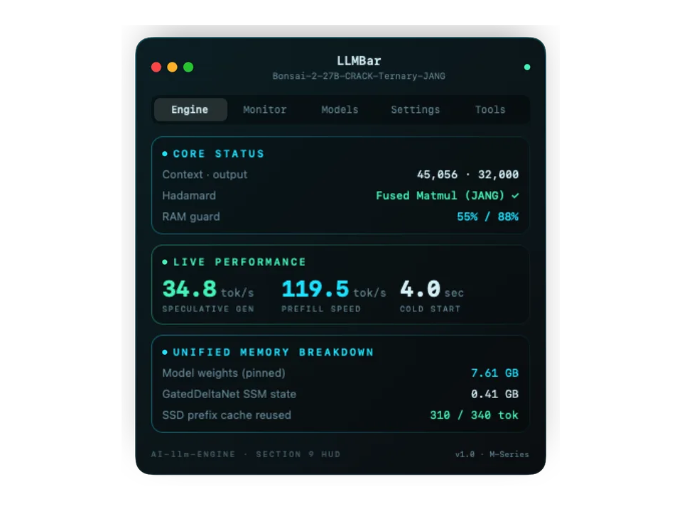

All screenshots

  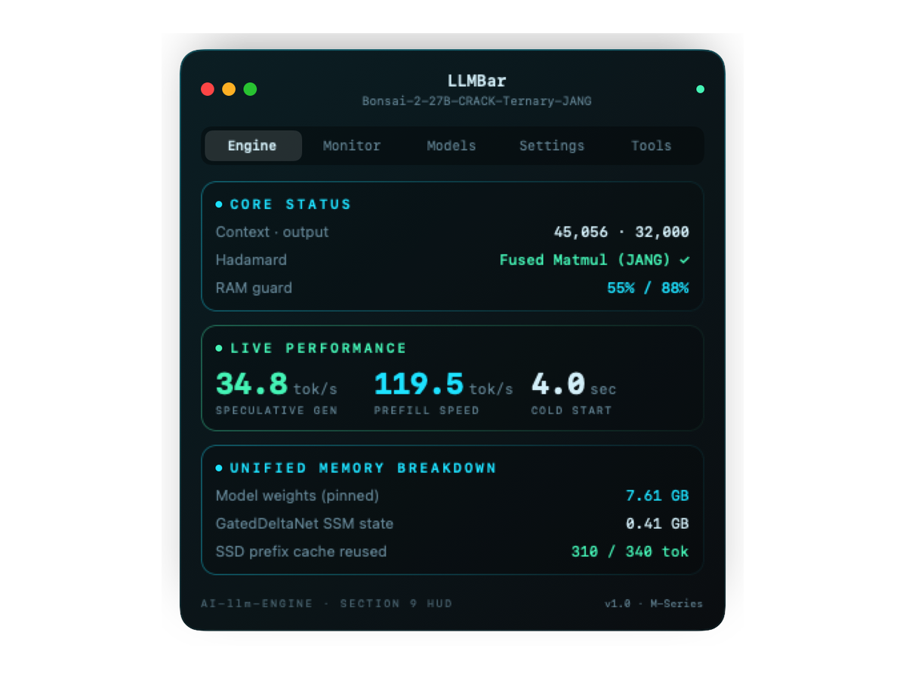
  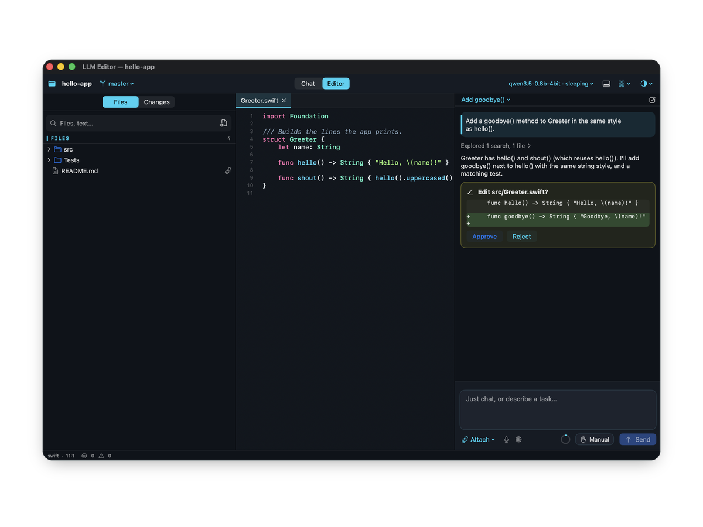
   
  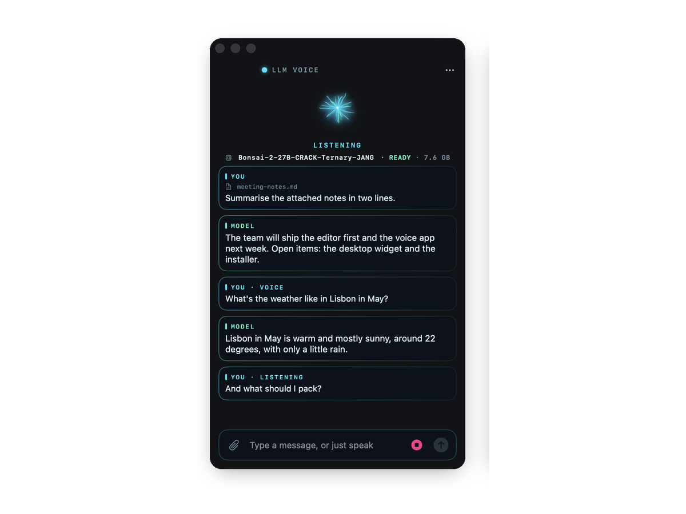
  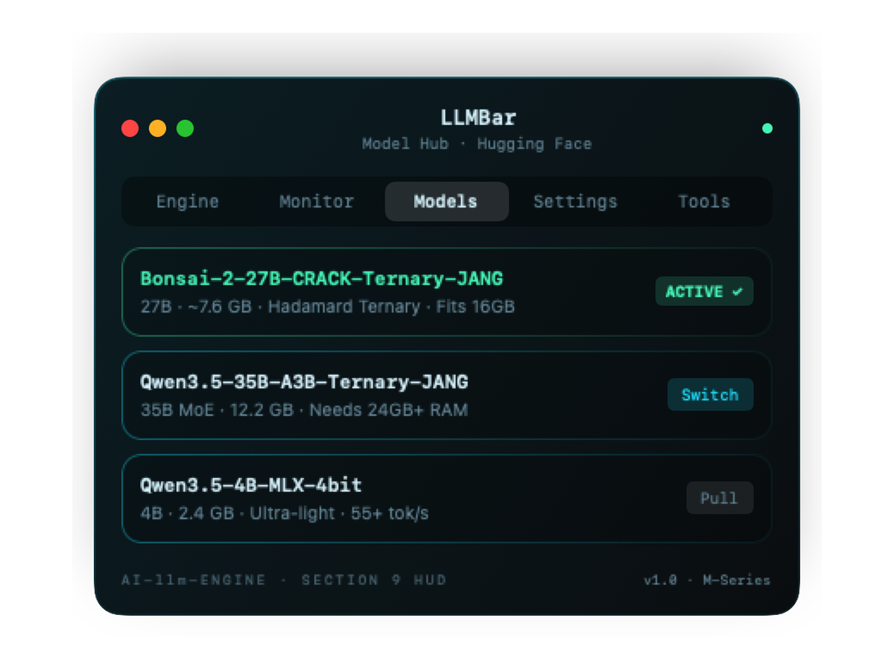
   
  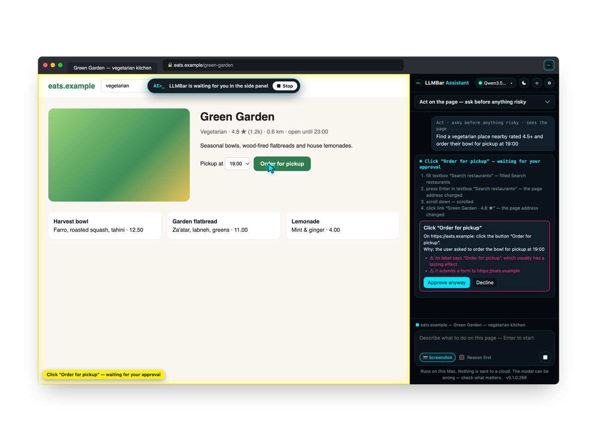
   
  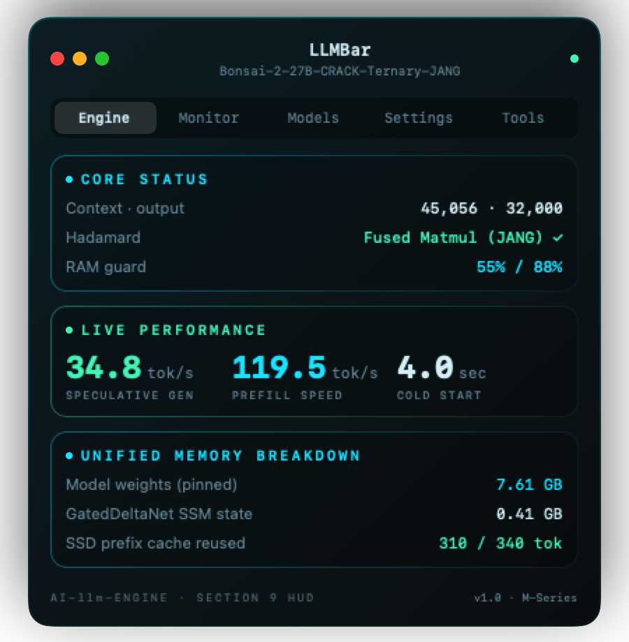
  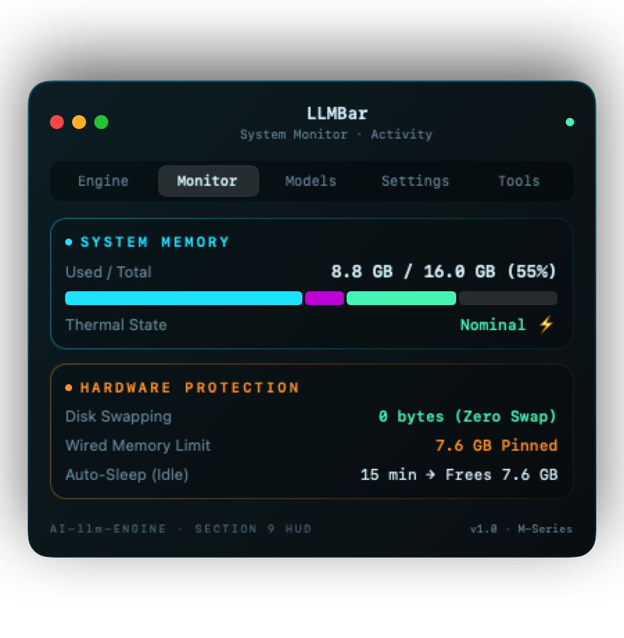
  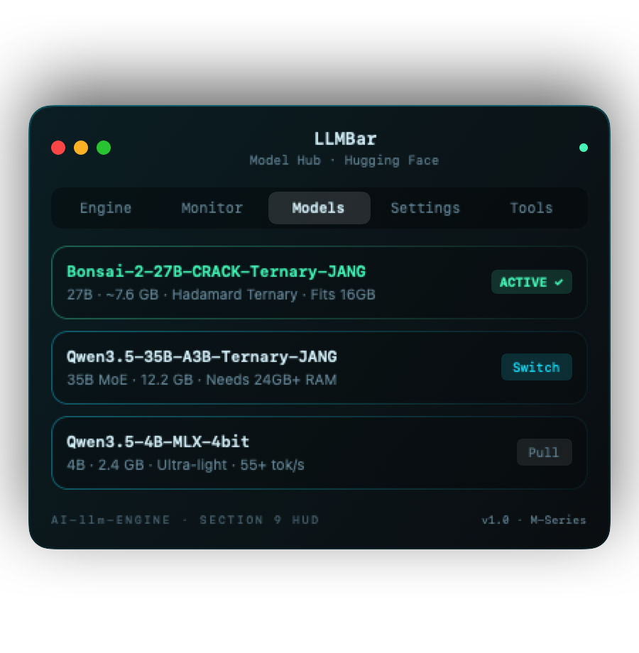

## One app, several ways to work

### Browser Assistant

Ask about the current page or give it a task such as creating a Google Keep note or filling a selected Google
Sheets cell. The assistant first uses page elements, then a screenshot and macOS Accessibility when a canvas app
has no reliable DOM target. A vision model sees the pixels; a text-only model still receives local Apple Vision
OCR and scene labels. A microphone button dictates locally into the selected page field; passwords, payment data,
one-time codes and CAPTCHA fields are always excluded.

Low-risk steps can run automatically. Sending mail, publishing, purchases, deletion, replacing existing content,
permissions and sensitive fields always stop for approval. Google Workspace sign-in uses PKCE, while refresh
tokens stay only in the macOS Keychain — never in the extension, page or model. Sheets cells, Docs text, Drive
documents, Gmail drafts and Calendar events use narrow named operations and offer Undo where possible.

[How the Browser Assistant works →](docs/safari-assistant/README.md)

### Local chat and voice

Use the compact menu-bar chat or speak naturally in LLM Voice. Conversations stay on the Mac. Ask for an image and
LLMBar can prepare the optional local generator with your approval; vision models are selected the same way by
what fits this Mac. Web search remains an explicit option rather than a hidden network dependency.

### Native code editor

Open a project, ask questions about the code, plan a change and review edits before they are applied. The same
local engine is also available to the editor or coding agent you already use.

### Knowledge from your documents

Create private libraries from PDFs, Markdown, text and source code. LLMBar searches only the libraries enabled for
that conversation and shows which pages or sections informed the answer. Library management now lives inside
Chat, beside the conversations it serves. Original files are never modified.

### Meet Lumo

  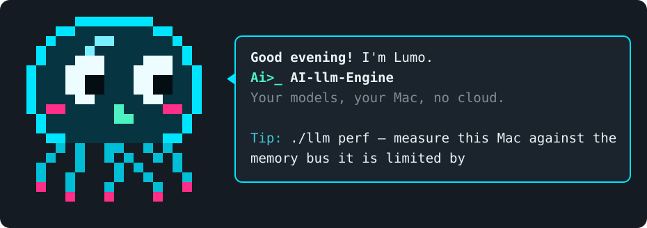

The command-line home is hosted by **Lumo**, a small glowing creature grown from LLMBar's orb. It greets you for
the time of day, moves its eyes and gives advice for the CLI section you are currently using.

## Private by design

- Models and conversations remain on your Mac.
- Screenshots are captured only for the task you start; their bytes are not written to chat history or logs, and
  deleting a chat clears its remaining short-lived action tickets.
- Browser permissions are per site and risky actions require approval.
- Scans and text-only image fallback use Apple Vision locally.
- Google OAuth tokens live in Keychain and are not exposed to browser pages.
- Cloud-backed extras are optional and clearly separated from offline features.

## Performance

On a 16 GB Apple M5, the native engine reaches about **115 tok/s on a compact model, 79 tok/s on 2B and 35 tok/s
on 4B**, while protecting memory for the rest of the system. Full methodology and reproducible tests live in the
technical documentation rather than on this product page.

## Get started

1. Download and move **LLMBar.app** to Applications.
2. Open it once. If macOS blocks it, press **Done**, then go to **System Settings ▸ Privacy & Security** and
   press **Open Anyway** beside the LLMBar message.
3. Open LLMBar again and choose a recommended model in **Models**.
4. Press **Start**.
5. Open chat, voice, the editor or **Tools ▸ Browser Assistant**.

The app runs on Apple Silicon Macs. Optional browser control needs Accessibility permission; ordinary page reading
and DOM actions continue to work without it.

## For developers

The engine exposes OpenAI-, Ollama- and Anthropic-compatible local endpoints at `localhost:8090`. Source builds,
API examples, model internals, benchmarks and test instructions are kept in dedicated documentation:

- [Complete developer guide: setup, CLI, API, models and benchmarks](docs/DEVELOPER_GUIDE.md)
- [Browser Assistant protocol](docs/safari-assistant/PROTOCOL.md)
- [Knowledge engine architecture](docs/KNOWLEDGE_ENGINE_ARCHITECTURE.md)
- [Model Lab and compatibility](docs/model-lab/compatibility.md)
- [Changelog](CHANGELOG.md)

Run `./llm help` from a source checkout for the current CLI reference.

## License

Apache-2.0 — see [LICENSE](LICENSE) and [NOTICE](NOTICE). Model weights are not included and keep their own
licenses.

---

[Русская версия](README.ru.md)
