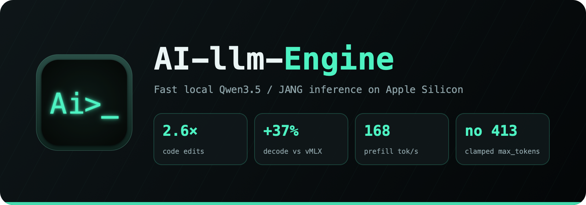
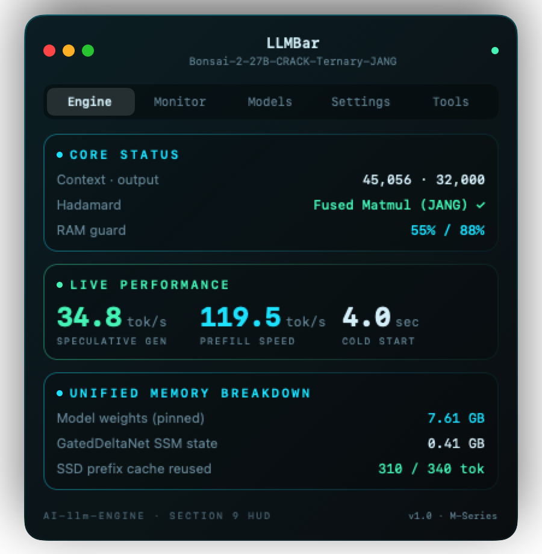
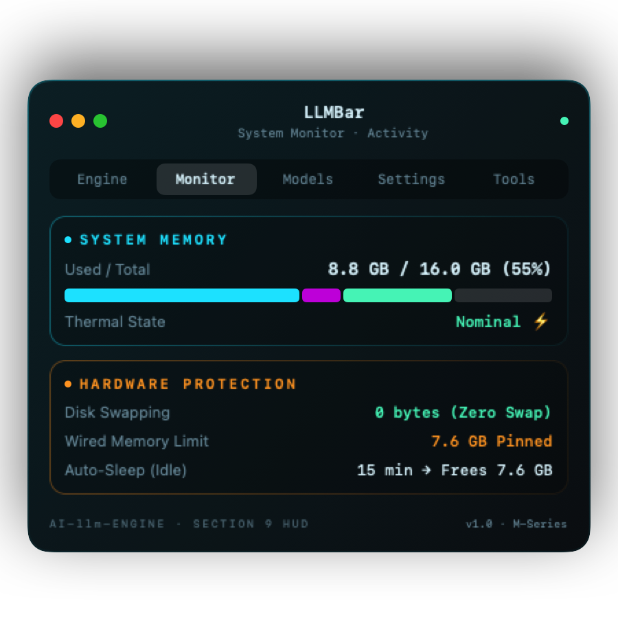
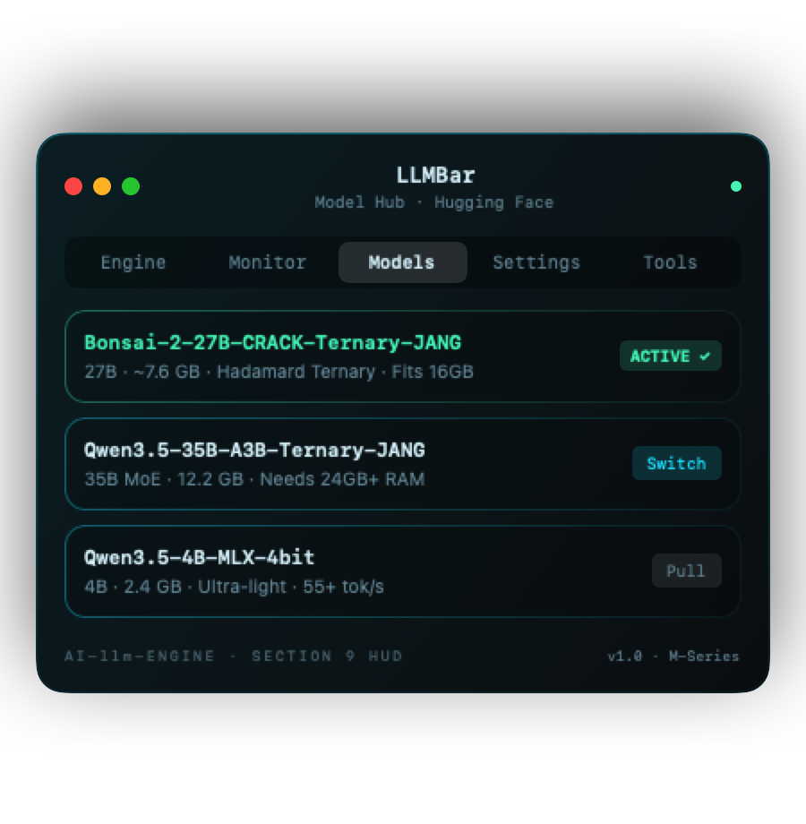

# AI-llm-Engine



A small, dependency-light MLX inference engine for **Qwen3.5-family models** on Apple Silicon. It includes the
**JANG / Prism Hadamard-rotated ternary** bundles that otherwise only run in vMLX, plus a CLI, a menu-bar app
and integrations for Continue, Kilo Code and opencode.

Built and tuned for a **MacBook Air M5, 16 GB** running
[`dealignai/Bonsai-2-27B-CRACK-Ternary-JANG`](https://huggingface.co/dealignai/Bonsai-2-27B-CRACK-Ternary-JANG)
(27B, ~7.6 GB).

[Русская версия](README.ru.md)

## Why

| Same Mac, same prompts, alternating runs | vMLX 1.6.75 | **llm-engine** |
|---|---|---|
| Decode speed (256 tokens) | 6.80 – 6.94 tok/s | **7.61 – 9.53 tok/s** (+12 – 37 %) |
| Code edits (prompt-lookup speculation) | — | **27 – 35 tok/s** (×2.5 vs plain decode) |
| Prefill speed (2.3K-token prompt) | 73.5 – 88.1 tok/s | **86.7 – 119.5 tok/s** (+18 – 36 %) |
| Cold start to first request | 19 s | **4 s** |
| Process memory on top of the weights | 1.26 GB | **0.66 GB** |
| Install size | 1.9 GB app | **310 MB** venv |
| `max_tokens` above the safe limit | HTTP 413 error | clamped, request succeeds |

The 413 error is what broke Kilo Code with vMLX. Kilo asks for 32,000 output tokens, and vMLX rejects anything above
its Metal headroom estimate (~8.5K on 16 GB).

## How it is fast

- **One Hadamard transform per shared input.** The bundle stores one sign vector per input width, not one per
  module. That was verified on load, and a bundle that differs is rejected. So q|k|v, gate|up and qkv|z each run as a
  single fused quantized matmul after one transform, where vMLX does one transform per projection.
- **Compiled layer blocks.** Decode is latency-bound by thousands of small dependent kernels, not only by weight
  bandwidth. `mx.compile`d blocks (norm→Hadamard, gated-delta pre/post, attention pre/post, MLP + residual) bring the
  full decode step to within ~11 % of the raw weight-read time.
- **Pinned weights.** The wired limit keeps the weights resident, so macOS cannot compress or swap them.
- **Hybrid-aware prefix cache.** The GatedDeltaNet state can't be rewound, so the engine snapshots it at the start of
  the generation prompt. An agent that resends the whole conversation only prefills the new tail (310 of 340 tokens
  reused in the tool-call test).
- **Prompt-lookup speculative decoding.** When the output repeats text that is already in the context (code edits,
  quotes, tool arguments), the engine drafts the continuation from an n-gram match and verifies it in one weight
  pass. Small batches are padded to MLX's tiled-matmul size, so verifying 15 drafted tokens costs about five decode
  steps. Acceptance is exact: the greedy output is identical to plain decoding, and sampled output keeps the same
  distribution. The hybrid GatedDeltaNet state rolls back by re-running only the cheap recurrence on the accepted
  tokens. It turns off by itself when nothing matches, so prose runs at plain speed.
- **Adaptive, not tuned to one laptop.** The context length is computed at start from RAM, model size and KV cost
  per token (about 45K on a 16 GB Mac; larger machines reach the model's native limit). The wired limit follows the
  GPU budget of the machine, and the vision tower (~0.5 GB) loads only on the first image request.
- **RAM guard.** The engine keeps the whole Mac under a memory ceiling, 88 % by default (`--mem-limit`, or Settings in
  `./llm`). Above ~90 % a 16 GB Mac starts swapping and freezes. Before a request, the guard checks the headroom and
  frees caches; it caps the output to what fits and refuses an oversized prompt with a clear error. During prefill it
  shrinks the chunk size (1024 → 256 → 128), and during generation it checks every 32 tokens. Peak memory while
  loading equals the weights (was +1.7 GB).
- **Last-position logits only** during prefill, chunked prefill, GPU-side top-k/top-p/min-p sampling and a pipelined
  (`async_eval`) decode loop.

A note on numbers: a fanless MacBook Air lowers GPU/memory clocks after a few seconds of full-bandwidth load. The raw
weight-read time goes from ~60 ms to ~95–120 ms per token regardless of engine, so expect 7–10 tok/s sustained on
this 27B model.

## Quick start

```sh
./llm setup        # creates .venv (mlx, tokenizers, jinja2, numpy, pillow)
./llm models       # lists models found in ~/.cache/huggingface/hub
./llm use 1        # select one
./llm open         # new Terminal window: starts the model and opens a chat
```

Double-clicking **`LLM.command`** in Finder does the same as `./llm open`. `./llm setup` is actually optional —
`start`/`open`/LLMBar's Start button create the `.venv` and install `requirements.txt` on first use anyway; the only
thing you need already on the Mac is Python 3.10+.

### Models: search, download, switch

```sh
./llm search qwen3.5            # MLX models on Hugging Face: size, downloads, "engine ✓", fits RAM
./llm pull mlx-community/Qwen3.5-4B-MLX-4bit   # resumable download into ~/.cache/huggingface/hub
./llm use 2                      # switch the active model (restarts the engine if it runs)
```

Downloads resume if interrupted, check free disk space first and skip weights the engine does not use. Set
`HF_ENDPOINT` to use a mirror (e.g. `https://hf-mirror.com`) and `HF_TOKEN` for gated repos. Both JANG bundles and
regular mlx-community / lmstudio-community conversions of the dense Qwen3.5 family run on the engine, including tied
embeddings and quantized gate projections.

### Sleep and the SSD prefix cache

- **Auto-sleep.** After 15 idle minutes (configurable, 0 = never) the engine unloads the weights and gives about 7 GB
  back to macOS. The next request wakes it in about 2 s.
- **SSD prefix cache.** The KV and recurrent state at two restore points per request (the end of the system prompt and
  the start of the answer) is written to `~/.cache/ai-llm-engine/prefix/` (configurable) when the model goes to sleep
  or the server shuts down cleanly — not after every single message, since a growing conversation's snapshot point is
  different every turn and writing the whole thing to disk each time would be wasteful SSD wear for a cache that's
  only a speed optimization. The budget is 8 GB by default (set it to `"auto"` for 10% of free disk space, or 0 to
  turn the cache off), and the least recently used entries go first. A long
  agent system prompt is prefilled once and then restored from disk across sleeps, restarts and model switches, with
  output identical to a cold run.

### Menu-bar app (optional)

```sh
./build-app.sh && open LLMBar.app      # app with icon (~2.5 MB, engine + CLI bundled)
./build-dmg.sh                         # dist/LLMBar-1.0.dmg — drag-to-Applications installer
```

LLMBar is the lightweight UI of the engine. It lives in the menu bar as a small `Ai_` icon. Click the icon to open a
frosted-glass panel right under it; click again, press Esc or click elsewhere to hide it (the model keeps running).
Double-clicking the app opens the same panel. If the icon is hidden behind the notch or another app's menus, ⌘-drag it
closer to the clock; its position is remembered. The panel follows a dark or light theme. It has five tabs:

- **Engine:** status, last-request speeds, the RAM guard meter, a token ledger for the session and all time (cache
  hits, averages, history chart), and a **memory card**. The card is one bar for the whole Mac: model weights, context
  (KV cache), recurrent state with prefix snapshots, engine buffers, the engine process, other apps and free memory,
  with the RAM-guard limit marked.
- **Monitor:** E- and P-core load, thermal state, GPU load and memory, and the memory breakdown, each with graphs.
- **Models:** installed models with one-click switching, plus hub search and download with progress.
- **Settings:** context, output, reasoning, images, speculation, RAM limit, sleep, SSD cache, port, LAN, API key,
  language and theme. An Advanced section holds sampling, draft length, n-gram, MLX cache, prefill chunk and image
  size. Every setting has a hint.
- **Tools:** chat, coding agent, connecting an editor, logs, tests and benchmarks.

<p align="center">
  
  
  
</p>

It polls only while the panel is open and does all its work through `./llm`. Built from a checkout, it uses that checkout. Installed
from the DMG on another Mac, it runs its bundled copy and keeps its config and `.venv` in
`~/Library/Application Support/LLMBar`. On the first Start it creates them, which needs Python 3.10+ and internet.

## CLI

```
./llm                      interactive menu
./llm open | up            new window with chat | start + chat + menu in this terminal
./llm start|stop|restart|status|chat|bench|logs
./llm models | use <n>     discover / select models
./llm agent [dir]          terminal coding agent (files, search, edits, shell)
./llm connect [client]     register the model in Continue, Kilo Code or opencode
./llm free                 quit vMLX / oMLX / Ollama to free memory
./llm test                 unit + integration tests
./llm perf [--save]        performance suite vs the saved baseline
./llm eval [--save]        accuracy suite (math / code / sanity) vs the saved baseline
./llm calibrate [--apply]  find the largest context that actually prefills on this Mac
```

Language is English by default and Russian when the system locale is Russian. You can force it with `LLM_LANG=ru` or
in Settings.

## API

OpenAI-compatible on `http://localhost:8090/v1`:

- `POST /v1/chat/completions` supports streaming, `reasoning_content`, tool calls (the model's XML format is converted
  to OpenAI `tool_calls`) and images (`image_url` with a data URI, http URL or file path).
- Thinking is controlled with `chat_template_kwargs.enable_thinking`, `reasoning_effort` (`low`, `medium`, `high`→`xhigh`)
  or `thinking: {type: "disabled"}`. When a request doesn't say, the model gets **its own template's default**
  (`--thinking auto`): on for Bonsai-27B, off for the small Qwen3.5 models, whose authors ship them with reasoning
  disabled — forcing it on is what makes a 0.8B write hundreds of tokens of "Thinking Process" before answering
  7 + 5. Models without a reasoning mode or a vision tower simply ignore those options (an image gets a clear 400).
- Sampling comes from the bundle (`jang_config` modes, else `generation_config.json`), and for a bundle that ships
  neither, from the Qwen3.5 family presets (temperature 1.0 / top-p 0.95 / top-k 20 when reasoning, 0.7 / 0.8 / 20
  with presence penalty 1.5 otherwise) — never "temperature 1.0 over the whole vocabulary", which sends a small model
  rambling. A runaway reasoning phase is cut off by a token budget (`--think-frac`) or by detecting a repeating loop,
  and the answer is then produced from the closed reasoning; `think_forced` in a request's stats says if that happened.
- `GET /v1/models`, `GET /health` (state, memory breakdown, cache, last request speed) and `GET /v1/stats` (token
  statistics for the session, all time and recent requests).
- The memory breakdown is also printed by `./llm status`. The engine's own footprint is measured like Activity
  Monitor does (`phys_footprint`, which includes Metal memory that RSS misses).

Any `model` name is accepted, since the server hosts exactly one model.

### Coding agent

`./llm agent [folder]` is a terminal coding agent that needs only this engine, with no VS Code and no Kilo. It can list,
read and search files, write files, make exact edits and run shell commands, all scoped to the folder. Writes, edits
and commands show a diff or the command line and ask first; `/auto` approves them for the session. It speaks the
user's language.

Optional extras, each off until you ask (nothing is contacted or added to the prompt by default):

| Command | What it does |
|---|---|
| `/web on` | `web_search` and `web_fetch`: search the internet (DuckDuckGo, no key; `LLM_SEARCH_URL` for a SearxNG) and read pages as clean text. Private/LAN addresses are refused; one question per session before anything goes out. |
| `/mcp add context7`, `/mcp on` | MCP servers from `.llm/mcp.json` (stdio or HTTP): Context7 for current library docs, [Stitch](https://stitch.withgoogle.com/) for UI designs (`/mcp add stitch`, key in `STITCH_API_KEY`). Switch whole servers or single tools; `/mcp` shows status and what the tool definitions cost per request. |
| `/workers on` | `delegate`: hand a self-contained sub-task to another model — any OpenAI-compatible endpoint (OpenAI, Anthropic, Gemini, a second local engine) or a CLI agent — configured in `.llm/workers.json`. Keys come from environment variables; the worker sees only the task and the files you approve, and each hand-off asks first. |
| `/fix-tests [command]` | Runs the tests, gives the model only the failing tests with tracebacks, lets it edit (each edit still asks), re-runs. Stops on green, after 5 rounds, or when two attempts change nothing. |
| `/memory`, `/remember <note>` | Standing project instructions from `.llm/memory.md`, `AGENTS.md` or `CLAUDE.md`. |
| automatic | `.llm/map.md` — a model-free map of the project (rebuilt only when files change) and `.llm/session.md` — the agent's own notes, saved on exit and read at start, so a restart does not re-scan the project. `/map` and `/save` do it on demand. |
| `/compact` | Long sessions are compacted automatically at 70% of the context window; this does it now. |

### Benchmarks

`./llm eval` has two modes. Without arguments it runs the small built-in regression suite (math, code, sanity).
With `--suite` it runs standard benchmarks zero-shot through the model's chat template, on a seeded random subset:

```sh
./llm eval --suite list
./llm eval --suite gsm8k,mmlu,arc,hellaswag --limit 100
./llm eval --suite humaneval,mbpp --allow-code     # executes the model's code locally
./llm eval --suite mmlu --limit 0                  # 0 = the full dataset
```

GSM8K, MathQA, MMLU, MMLU-Pro, ARC-Challenge, HellaSwag, TruthfulQA (MC1), WinoGrande, KMMLU (Korean), C-Eval (Chinese),
BBQ, SafetyBench (dev, 35 questions: the test answers are withheld), HumanEval and MBPP are supported (HumanEval/MBPP
code runs in a macOS sandbox without network and without writes outside a throw-away folder);
datasets come from the Hugging Face datasets server and are cached. The score is generative zero-shot accuracy with a
95 % interval, so it is comparable between models and between runs of this tool, not with published
log-likelihood or few-shot numbers. Stop the engine first.

### Editors: Continue, Kilo Code, opencode

Nothing is tied to one editor. Run `./llm connect` and pick one, or name it directly:

```sh
./llm connect continue   # ~/.continue/config.yaml — adds a managed block, keeps your other models
./llm connect kilo       # ~/.config/kilo/kilo.jsonc
./llm connect opencode   # ~/.config/opencode/opencode.json
```

Each one gets the engine URL, tool and image capabilities, and the context and output limits of the running engine.
A `.bak` copy is kept, and running it again only updates its own entry. Any other OpenAI-compatible client works with
`http://localhost:8090/v1`.

## Run the engine directly

```sh
.venv/bin/python -m engine.server --model <path> --port 8090 \
    --context 32768 --max-tokens 8192 --thinking auto --effort medium [--no-vision]
```

## Tests

```sh
./llm test
# or: ENGINE_TEST_MODEL=<model path> .venv/bin/python -m unittest discover -s tests -v
```

There are 43 unit tests (engine, CLI and the coding agent): Hadamard against an explicit matrix, fused vs separate
projections, caches, M-RoPE, the sampler, the drafter, speculative acceptance (it keeps the sampling distribution),
SSM rollback (equal to sequential), the reasoning/tool-call stream parser, message normalization, the repetition
detector, the RAM-guard grace band, and which shell commands the coding agent always confirms. There are also 9
integration tests on the real model: a correct answer, UTF-8 streaming detokenization, bit-exact prefix-cache reuse,
speculative greedy identical to plain greedy, the RAM guard refusing instead of swapping, the SSD prefix cache
surviving a restart with identical output, sleep and wake, `max_tokens` clamping, and the think-budget guard forcing
an answer instead of an endless `<think>`.

### Performance and accuracy suites

```sh
./llm perf            # speed: compare with tests/perf_baseline.json; exits 1 on >15 % regressions
./llm perf --save     # record a new baseline after an intentional change
./llm eval            # quality: compare with tests/eval_baseline.json
./llm eval --save
```

`perf` measures load time, decode step, the cost of a 16-token verify pass, prefill at three prompt sizes, prose and
code-edit speed, draft acceptance, peak memory and peak system RAM. `eval` complements it with a quality check — math
word problems, function-completion problems graded by actually running the generated code, and trivial sanity
questions that must finish cleanly rather than loop — so a change that quietly breaks answers gets caught, not just
one that slows them down. It runs each model in its own default reasoning mode with the model's sampling presets and a fixed seed (`--think on|off` and `--greedy` change that — reasoning models loop under greedy decoding, so a greedy benchmark mostly measures the loops) and reports how many replies had their reasoning force-closed or hit the token limit. Both accept a repeated `--model PATH` to compare several models in one run. Stop the
server first. If memory runs short, a metric is skipped instead of freezing the Mac.

`./llm calibrate [--apply]` checks the auto-context formula (RAM × limit − weights, divided by KV cost per token)
against reality instead of only trusting the math: it binary-searches real prefill attempts, each in its own fresh
subprocess so a hard crash at one size only rules out that size. `--apply` writes the result as the model's context
(no longer `auto`) once it's confirmed to actually fit, not just computed to.

## Supported models

Quantized MLX checkpoints of the `qwen3_5` dense family, with or without the JANG Hadamard contract and with or
without the vision tower. MoE variants, video and other architectures are not supported (yet). `./llm models` shows
compatibility for every model it finds.

## Layout

```
engine/   model.py (layers, Hadamard, fused ops) · loader.py · vision.py · gated_delta.py
          tokenizer.py · generate.py (cache, sampling) · server.py (HTTP)
llm.py    CLI / menu (stdlib only) — locales/ru.json for Russian
agent.py  terminal coding agent (stdlib only) · harness/ optional web / MCP / memory / compaction / fix-tests modules
app/      LLMBar.swift (menu-bar app)
tools/    icon / DMG background / banner generators (Swift)
build-app.sh, build-dmg.sh
tests/    unittest suite · perf.py + perf_baseline.json · eval.py + eval_baseline.json
```

## License

Apache-2.0 — see [LICENSE](LICENSE). Parts are derived from vMLX and jang (Apache-2.0), and from mlx-lm and mlx-vlm
(MIT). See [NOTICE](NOTICE) and `third_party/`. Model weights are not included and have their own licenses.
