# AI-llm-Engine

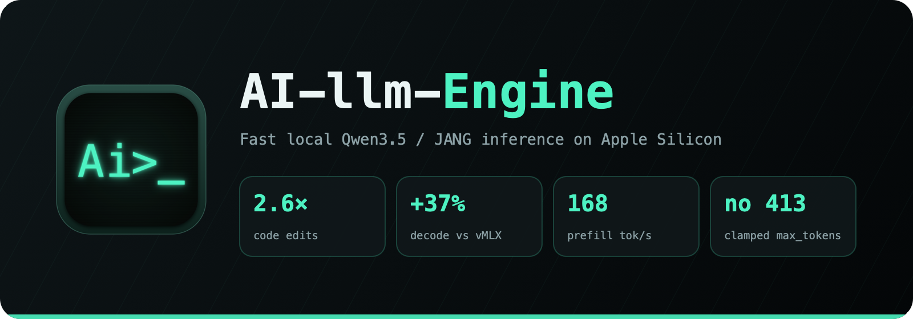

**Приватный ИИ для всего Mac — чат, голос, код и браузер на одной локальной модели.** Без облака, подписки и
аккаунта: модель скачивается один раз и работает офлайн, ничего не покидает компьютер.

**[⬇ Скачать LLMBar.dmg](https://github.com/dsavenk0/AI-llm-Engine/releases/latest/download/LLMBar.dmg)**

> **Первый запуск на macOS:** текущая сборка не подписана сертификатом Apple Developer ID и не нотаризована,
> поэтому Gatekeeper один раз её блокирует. Попробуйте открыть LLMBar, нажмите **Готово**, затем откройте
> **Системные настройки ▸ Конфиденциальность и безопасность**, найдите сообщение о LLMBar, нажмите **Открыть всё
> равно** и подтвердите запуск. В дальнейшем приложение открывается обычно.

## Чем он отличается

- **🌐 Браузерный агент, который ничего никуда не отправляет.** В Safari, Firefox и Chromium он читает страницу,
  отвечает на вопросы, заполняет формы и выполняет многошаговые задачи. Где возможно — через DOM, где нужно — с
  помощью зрения. Перед отправкой, покупкой, удалением или перезаписью всегда спрашивает подтверждение.
- **🧠 Локальные модели без привычных ограничений.** MLX и GGUF, включая модели больше доступной RAM. LLMBar ещё до
  загрузки проверяет совместимость и память, а затем сам выбирает подходящий движок.
- **🛡 Для обычного Mac, а не только рабочей станции.** Общая защита памяти сохраняет отзывчивость Mac на 16 ГБ,
  даже когда модель одновременно используют несколько приложений.
- **⚡ Быстро на Apple Silicon.** Нативный Metal, кэш промптов и спекулятивная генерация ускоряют чат и правки кода.
  В измеренном сравнении на 27B JANG движок был готов примерно за **4 секунды**.
- **🎙 Голос, файлы и изображения.** Можно говорить естественно, менять язык, по желанию искать в интернете и
  разбирать PDF, сканы, фотографии и голосовые заметки прямо на Mac.
- **🔌 Один приватный API для ваших инструментов.** Continue, Kilo Code, opencode, Cline и другие клиенты форматов
  OpenAI, Ollama и Anthropic работают с тем же локальным движком.

### Измеренное сравнение с другим локальным движком

Одна модель 27B JANG, Apple M5 с 16 ГБ, последовательные прогоны в октябре 2026 года:

| | Движок LLMBar | vMLX 1.6.75 |
|---|---:|---:|
| Холодный запуск до первого запроса | **4 с** | 19 с |
| Генерация текста | **7,61–9,53 ток/с** | 6,80–6,94 ток/с |
| Prefill на 2,3K токенов | **86,7–119,5 ток/с** | 73,5–88,1 ток/с |
| Память процесса сверх весов | **0,66 ГБ** | 1,26 ГБ |
| Размер установленного рантайма | **310 МБ** | 1,9 ГБ |

Это датированный замер одной модели, а не обещание для любого checkpoint. В [руководстве разработчика](docs/DEVELOPER_GUIDE.ru.md)
есть условия, новые результаты на компактных моделях и архитектурное сравнение с Ollama, LM Studio и llama.cpp.

  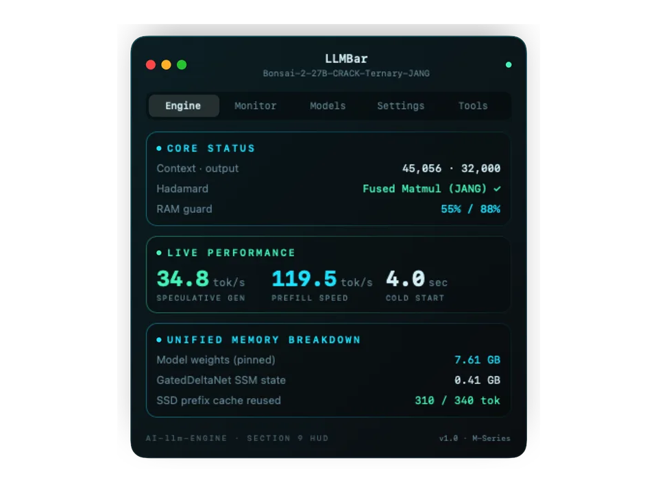

Все скриншоты

  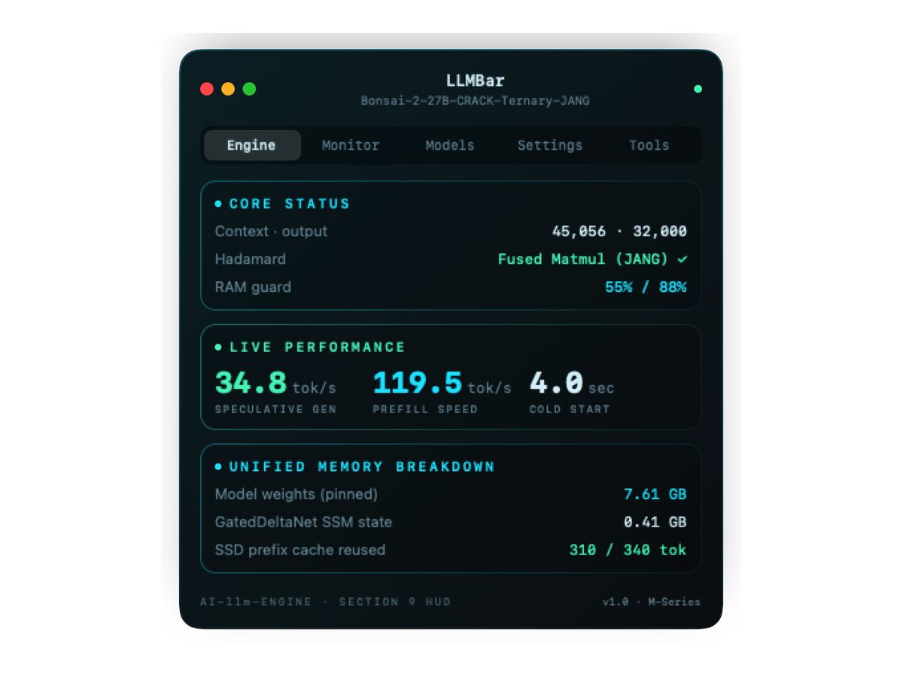
  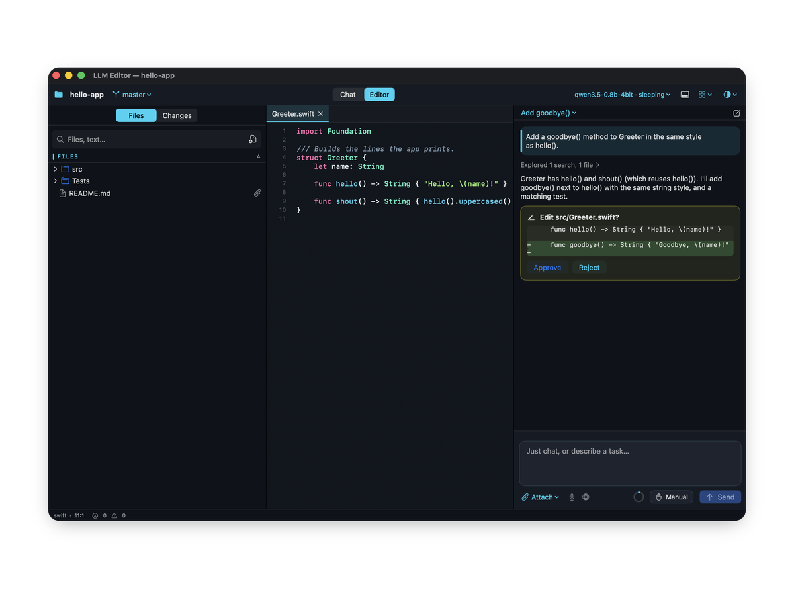
   
  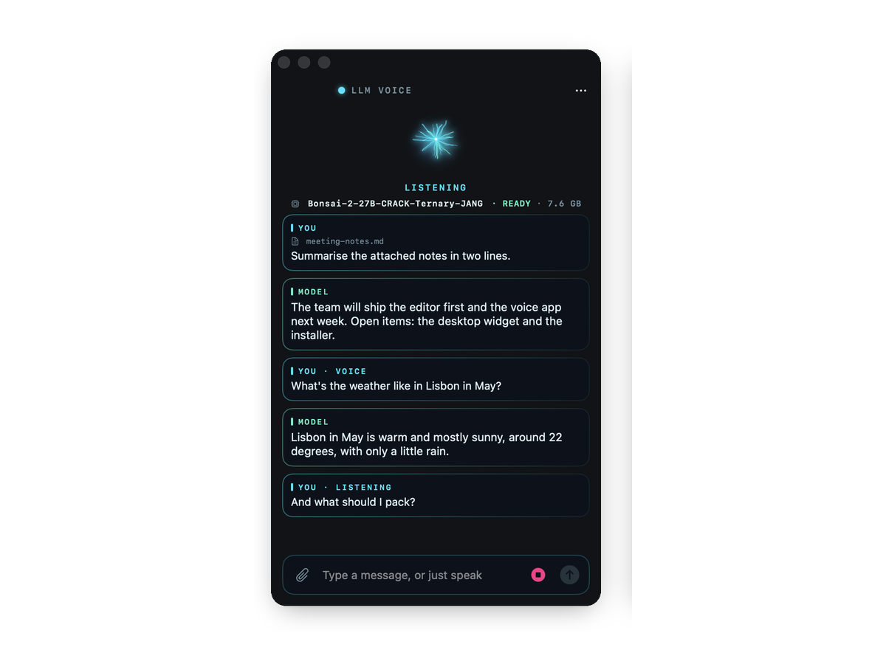
  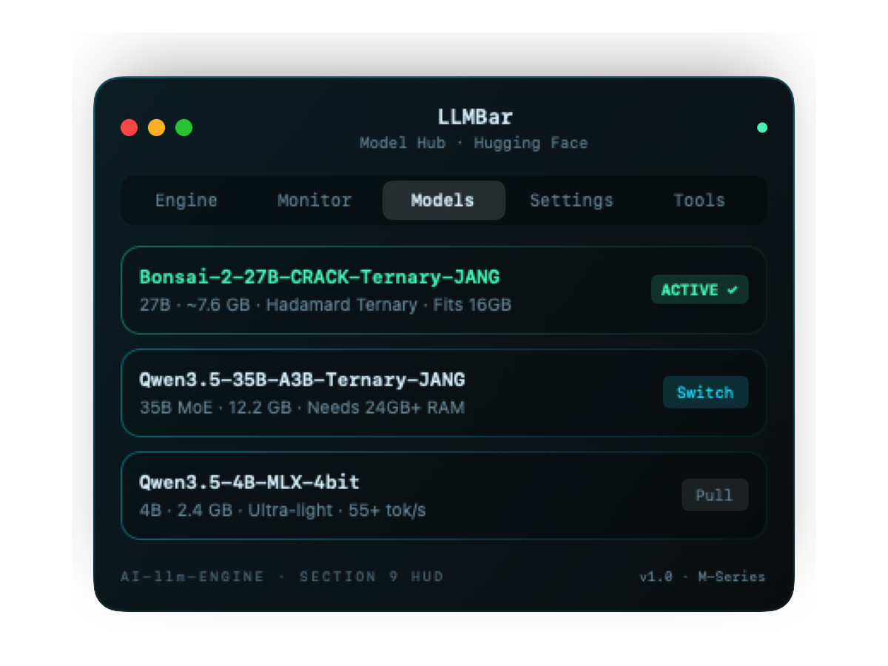
   
  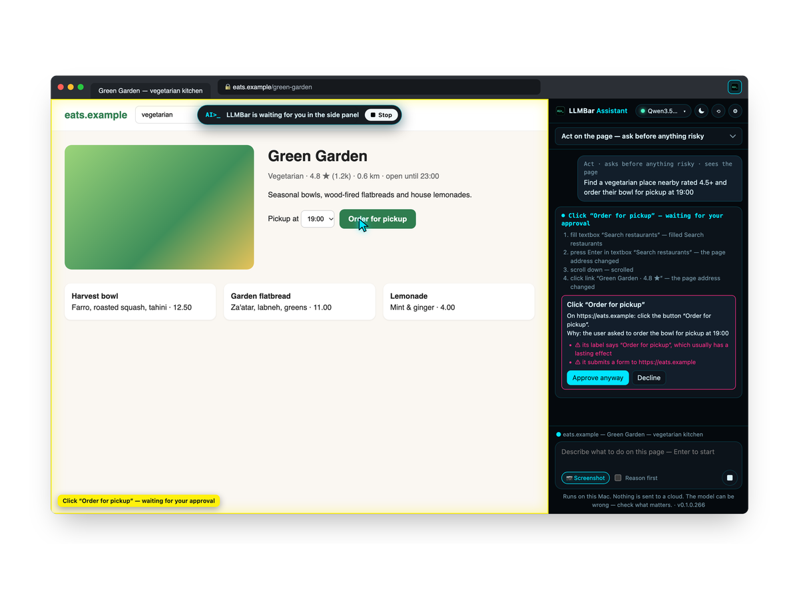
   
  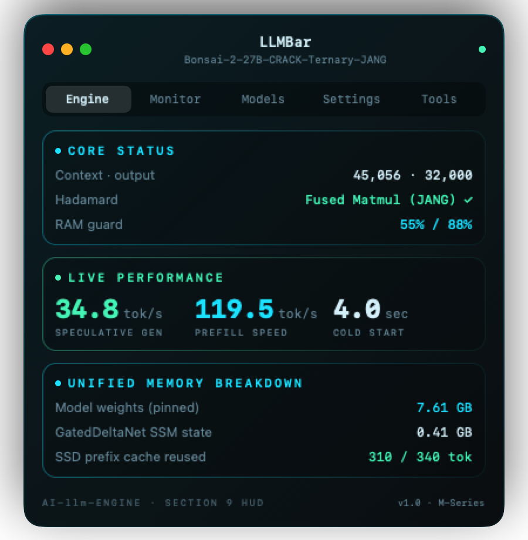
  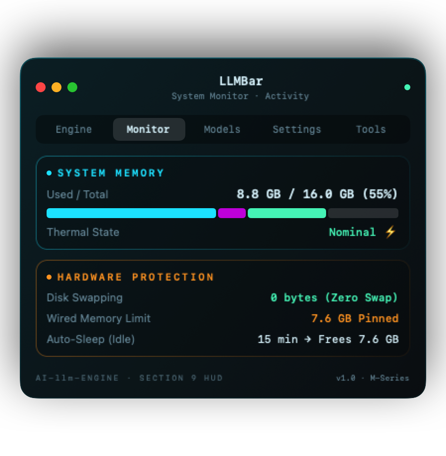
  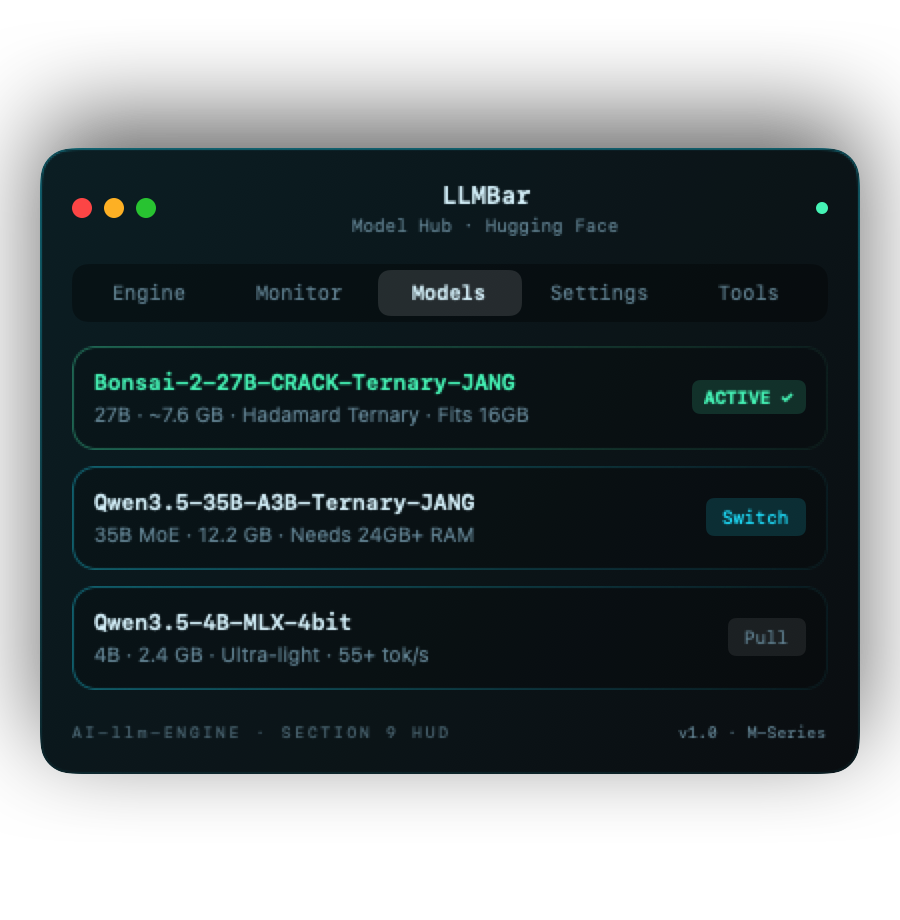

## Одно приложение — несколько способов работать

### Браузерный ассистент

Спросите о текущей странице или поручите задачу — например, создать заметку Google Keep либо заполнить выбранную
ячейку Google Sheets. Сначала ассистент использует элементы страницы, а если canvas-приложение не даёт надёжной
цели — скриншот и Accessibility macOS. Vision-модель видит пиксели; текстовая модель всё равно получает локальный
OCR Apple Vision и метки сцены. Кнопка микрофона локально распознаёт речь и вставляет её в выбранное поле страницы;
пароли, платёжные данные, одноразовые коды и CAPTCHA всегда исключены.

Низкорисковые шаги могут выполняться сами. Отправка письма, публикация, покупка, удаление, замена существующих
данных, изменение доступа и чувствительные поля всегда требуют подтверждения. Авторизация Google Workspace
использует PKCE, а refresh token хранится только в Связке ключей macOS — не в расширении, странице или модели.
Запись в Sheets и Docs, создание документов Drive, черновиков Gmail и событий Calendar выполняются узкими
именованными операциями, которые по возможности можно отменить.

[Как устроен браузерный ассистент →](docs/safari-assistant/README.md)

### Локальный чат и голос

Используйте компактный чат в строке меню или говорите с LLM Voice. Разговоры остаются на Mac. Попросите создать
картинку — LLMBar с вашего подтверждения подготовит локальный генератор; vision-модель так же выбирается по памяти
этого Mac. Поиск в интернете остаётся явной возможностью, а не скрытой зависимостью от облака.

### Нативный редактор кода

Откройте проект, задайте вопрос по коду, составьте план и просмотрите правки перед применением. Тот же локальный
движок можно подключить к уже привычному редактору или кодовому агенту.

### Знания из ваших документов

Создавайте приватные библиотеки из PDF, Markdown, текста и исходного кода. LLMBar ищет только в библиотеках,
включённых для конкретного разговора, и показывает страницы и разделы, на которых основан ответ. Управление
библиотеками теперь находится прямо в Chat, рядом с разговорами. Исходные файлы никогда не меняются.

### Знакомьтесь: Люмо

  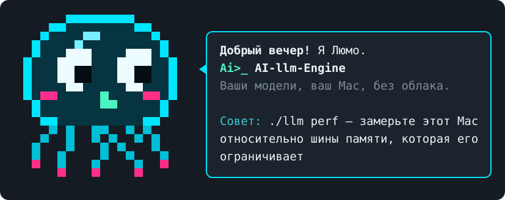

В командной строке вас встречает **Люмо** — маленькое светящееся существо, выросшее из шара LLMBar. Оно
приветствует по времени суток, двигает глазами и даёт подсказки по текущему разделу CLI.

## Приватность заложена в основу

- Модели и разговоры остаются на Mac.
- Скриншот создаётся только для запущенной вами задачи; его байты не записываются в историю или логи, а удаление
  чата очищает оставшиеся краткоживущие билеты действий.
- Доступ браузера выдаётся по сайтам, рискованные действия требуют подтверждения.
- Сканы и изображения для текстовой модели распознаются локальным Apple Vision.
- Токены Google OAuth хранятся в Связке ключей и не передаются веб-страницам.
- Возможности с облачными сервисами необязательны и отделены от офлайн-функций.

## Скорость

На Apple M5 с 16 ГБ нативный движок выдаёт около **115 ток/с на компактной модели, 79 ток/с на 2B и 35 ток/с
на 4B**, одновременно защищая память для остальных программ. Полная методика и воспроизводимые тесты находятся
в технической документации, а не на продуктовой странице.

## Начало работы

1. Скачайте и перенесите **LLMBar.app** в «Программы».
2. Один раз попробуйте открыть приложение. Если macOS заблокирует запуск, нажмите **Готово**, затем перейдите в
   **Системные настройки ▸ Конфиденциальность и безопасность** и нажмите **Открыть всё равно** рядом с сообщением
   о LLMBar.
3. Снова откройте LLMBar и выберите рекомендованную модель в разделе **Модели**.
4. Нажмите **Запуск**.
5. Откройте чат, голос, редактор или **Инструменты ▸ Браузерный ассистент**.

Приложение работает на Mac с Apple Silicon. Для управления браузером через настоящий курсор нужно разрешение
Accessibility; чтение страницы и обычные DOM-действия работают и без него.

## Для разработчиков

Движок предоставляет локальные API форматов OpenAI, Ollama и Anthropic на `localhost:8090`. Сборка из исходников,
примеры API, устройство моделей, бенчмарки и тесты вынесены в отдельную документацию:

- [Полное руководство: установка, CLI, API, модели и бенчмарки](docs/DEVELOPER_GUIDE.ru.md)
- [Протокол браузерного ассистента](docs/safari-assistant/PROTOCOL.md)
- [Архитектура Knowledge](docs/KNOWLEDGE_ENGINE_ARCHITECTURE.md)
- [Model Lab и совместимость](docs/model-lab/compatibility.md)
- [История изменений](CHANGELOG.ru.md)

Актуальная справка CLI в checkout доступна через `./llm help`.

## Лицензия

Apache-2.0 — см. [LICENSE](LICENSE) и [NOTICE](NOTICE). Веса моделей не входят в репозиторий и сохраняют собственные
лицензии.

---

[English version](README.md)
