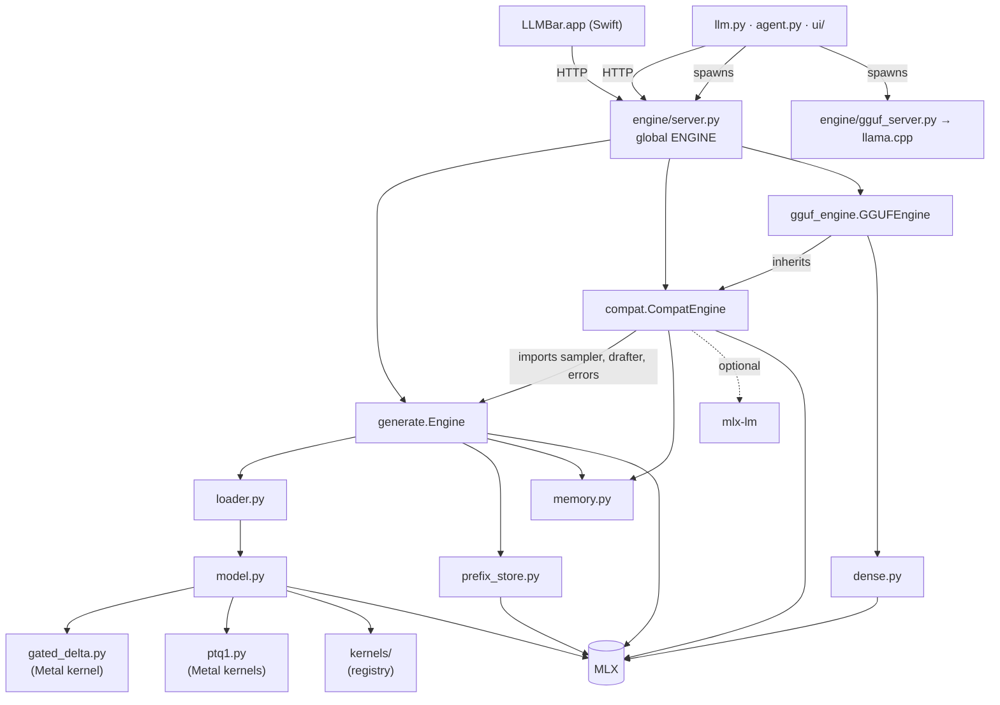

# Architecture review

An audit of the engine as it stands, made before changing its architecture: what the components are,
how they depend on each other and on MLX, and where a decode step's time actually goes.

**Headline.** The engine was believed to be bound by memory bandwidth, and at a short context it
nearly is. At a long context it was not: two dtype leaks made it read and convert far more than the
model needs. Fixing them — a dozen lines, no new kernel — made decode **at least 1.2× faster at a short
context and 2 – 3× faster at 8K – 32K**, with the same greedy output. A hand-written Metal
attention kernel, the change this audit set out to justify, measured at parity with MLX and ships
switched off. Details in [Findings](#findings).

Machine and method for every figure: Apple M5 (4P + 6E), 16 GB, macOS 26.4.1, MLX 0.32.3,
`mlx-community/Qwen3.5-0.8B-4bit` — the only Qwen3.5 checkpoint installed at the time; the README's
2B and 4B figures were not re-run. The machine was in ordinary use (79 – 83 % of RAM occupied, an IDE
open), and it is fanless: absolute times moved by up to 50 % between a cool and a warm run, so
before/after pairs were taken alternately in one session and the *ratios* are the result. Scripts:
`tests/layer_profile.py`, `tests/profile.py`, `tests/perf.py`, `tests/bench_kernels.py`.

## 1. Components as they are

| Area | Files | Lines | Role |
|---|---|---|---|
| CLI | `llm.py` | 4 167 | everything a user types: models, serve, chat, perf, lab, setup |
| Agent, UI, harness | `agent.py`, `ui/`, `harness/` | ~5 700 | terminal coding agent, web UI server, optional modules |
| macOS app | `app/` (Swift) | ~11 400 | menu-bar panel, editor, voice — an HTTP client of the server |
| HTTP server | `engine/server.py`, `anthropic.py`, `ollama.py`, `parsers.py`, `structured.py`, `stopfilter.py` | ~2 400 | three wire formats, SSE, queue, batcher, sleep |
| Native engine | `engine/generate.py` | 1 201 | `Engine`: load, memory guard, prefix cache, decode loop, sampler, speculation |
| Native model | `engine/model.py`, `gated_delta.py`, `ptq1.py`, `vision.py`, `loader.py`, `quant.py` | ~1 900 | Qwen3.5 hybrid on MLX, own Metal kernels for the recurrence and ternary weights |
| GGUF, own decoder | `engine/dense.py`, `gguf*.py`, `gguf_engine.py`, `convert.py` | ~1 800 | dense Llama-family transformer on MLX from GGUF weights |
| Compat engine | `engine/compat.py` | 645 | `CompatEngine`: mlx-lm models behind the same server |
| llama.cpp route | `engine/gguf_server.py` | 377 | a separate server process speaking the same API |
| Memory | `engine/memory.py`, `prefix_store.py` | 211 | system RAM watchdog (ctypes, no MLX), SSD prefix cache |
| Research tooling | `engine/steering.py`, `weightpatch.py`, `model_lab/`, `engine/cluster.py`, `adar/` | ~1 200 | activation and weight edits, pipeline parallelism, cluster protocol |
| Kernels (new) | `engine/kernels/` | ~240 | registry of replaceable operations; attention-decode kernel |

### What is already well separated

* **Application ↔ engine is HTTP.** The Swift app, the agent and the UI are clients. `llm.py` imports
  only stdlib-only engine modules (`gguf`, `modelinfo`, `preflight`).
* **The server holds no tensors.** It handles ids, strings and dicts; its only MLX calls are four
  memory counters in `/health`.
* **Whole-engine fallbacks are whole.** mlx-lm is a class, llama.cpp is a process; neither is mixed
  into the native forward pass.
* **Custom Metal already exists and is isolated**: the gated-delta recurrence, and three kernels for
  1.75-bit ternary weights, each in one file with its measurements in the header.

### What is not

| # | Coupling | Where | Consequence |
|---|---|---|---|
| C1 | `Engine` is four components in one class: model lifecycle, memory guard, prefix cache, decode loop | `generate.py` | no part can be replaced or tested alone; a second runtime would have to re-implement all four |
| C2 | `CompatEngine` repeats the guard, sleep/wake and prefix logic rather than sharing it | `compat.py` vs `generate.py` | two implementations of the product's headline feature (the RAM guard) to keep in step |
| C3 | The backend interface is implicit: `server.py` touches 29 attributes and methods of `ENGINE`, three of them behind `hasattr` | `server.py` | a new backend learns its contract from `AttributeError` |
| C4 | Two `KVCache` classes with different method names | `model.py`, `dense.py` | `batch.py`, `prefix_store.py` and speculation each work with one of them only |
| C5 | Backend choice is split between the CLI (which process) and the server (which class) | `llm.py`, `compat.pick_backend` | "why did this model run there?" has no single answer |
| C6 | The decode loop calls MLX directly — `async_eval`, `.item()`, `mx.array`, `argmax` | `Engine.generate` | the Inference Core cannot drive anything but MLX |
| C7 | Memory budgets are computed from assumptions about dtypes that nothing verifies | `kv_per_token` in `generate.py`, `compat.py` | see finding F1: the assumption was false for half the supported checkpoints |

## 2. MLX coupling

References to `mx.` / `mlx` per module (a count, to show where the weight is — not a quality score):

| Module | Refs | Kind of use |
|---|---|---|
| `generate.py` | 77 | arrays in the loop, sampler on the GPU, eval scheduling, memory limits and counters |
| `dense.py` | 66 | the model: `quantized_matmul`, `gather_qmm`, `fast.rope`, `fast.scaled_dot_product_attention` |
| `model.py` | 61 | the model: the same plus `mx.compile`, `hadamard_transform` |
| `compat.py` | 53 | as `generate.py`, for mlx-lm models |
| `ptq1.py` | 26 | `mx.fast.metal_kernel` hosts for own Metal code |
| `loader.py` | 23 | `mx.load`, concatenation of fused projections, dtype conversion |
| `server.py` | 19 | memory counters for `/health` (the rest are matches on the word in strings) |
| `vision.py`, `batch.py`, `audio.py` | 17, 14, 14 | model code |
| everything else in `engine/` | ≤ 9 each | incidental |
| `memory.py`, `tokenizer.py`, `structured.py`, `gguf.py`, wire formats | 0 | — |

Four kinds of dependency, in increasing order of how hard they are to replace:

1. **Counters and limits** (`get_active_memory`, `set_wired_limit`, `clear_cache`): 30 call sites, all
   trivially behind a Memory Manager.
2. **Scheduling** (`eval`, `async_eval`, `.item()`): a dozen sites in the two decode loops. Small in
   number, but they *are* the pipelining that saves 15 % of a step.
3. **The model as an MLX graph** (`model.py`, `dense.py`): by design. This is the MLX backend.
4. **`mx.compile`**: fuses the elementwise chains between matmuls, and only works on MLX arrays.
   Anything that wraps arrays in an abstraction loses it. This is the reason the proposed Runtime seam
   sits at the forward pass and not at the tensor.

`mx.fast.metal_kernel` deserves its own line: it is how the engine's Metal code runs today, *inside*
MLX's graph and allocator. Stage 2 keeps that host. The kernel sources are plain Metal Shading
Language and move to a native runtime unchanged.

## 3. Where a decode step goes

### Split by responsibility (512-token context, before the fixes)

`tests/profile.py`:

| | Time | Share |
|---|---|---|
| Whole step, as the engine runs it | 5.96 ms | 100 % |
| Reading the weights at the measured bus rate (115 GB/s) | 3.68 ms | 61.8 % |
| GPU work above that floor | 2.20 ms | 37.0 % |
| CPU and Python outside the forward pass | 0.07 ms | 1.3 % |
| (the same forward without pipelining) | 6.77 ms | +15 % |

Two conclusions that shape the roadmap:

* **The loop is not worth rewriting in C.** Everything outside the GPU is 1.3 % of the step.
* **Not all of the rest is the bus.** More than a third of the step was GPU work beyond reading the
  weights. That is where to look, and F2 below is part of what was in it.

### Split by layer (before the fixes)

`tests/layer_profile.py`, context 512 → 32 768:

| | 512 | 32 768 | Growth |
|---|---|---|---|
| Attention layers (6) | 1.00 ms | 19.77 ms | +18.77 ms |
| GatedDeltaNet layers (18) | 3.58 ms | 3.78 ms | +0.20 ms |
| Whole step | 6.42 ms | 25.37 ms | |
| Bytes read ÷ time | 71 GB/s | 42 GB/s | |

At 32K the six attention layers were 78 % of the step and read their cache at ~22 GB/s. The profiler's
own docstring records this figure and five explanations already ruled out, concluding it was "the
efficiency of the chain". It was not; see F1.

## Findings

### F1 — V was stored in the KV cache as float32 *(fixed)*

mlx-community conversions store quantization `scales` and `biases` as **bfloat16**. In MLX, a float16
input times a bfloat16 scale promotes to float32, so `quantized_matmul` returned float32. In
`attn_pre`, Q and K pass through `rms(...).astype(F16)`; V did not, and went into the cache as float32.

Consequences, all confirmed by measurement:

* the V half of the cache was twice its intended size — KV at 32K: 580 MB instead of 387 MB;
* `scaled_dot_product_attention` received float16 Q/K and float32 V and converted on every step.
  In isolation the same call on a float16 cache reads at ~99 GB/s (`tests/bench_kernels.py`);
* the context budget (`kv_per_token`, 2 bytes per element) under-counted the cache by 50 %, so the
  auto-context and the RAM guard were working from a figure that was too small.

Fix: one `.astype(F16)` in `attn_pre` (`engine/model.py`). JANG / Prism bundles store float16 scales
and were never affected — which is why the 27B numbers gave no hint of it.

### F2 — every quantized matmul and norm promoted to float32 *(fixed)*

The same cause, model-wide: 345 of the loaded model's 478 parameter arrays were bfloat16 (scales,
biases, norm weights), so every projection output and every norm was float32 and was cast back by the
next block — an extra pass over each activation, and float32 logits over a 248 320-token vocabulary.

Fix: the loader converts bfloat16 scales, biases, norm and conv weights of the language model to
float16 (`engine/loader.py`). Checked on this checkpoint, tensor by tensor: of its 489 bfloat16
language-model tensors 470 convert exactly; 18 conv weights and one scales tensor hold values below
float16's normal range and differ by at most 3·10⁻⁸. The a/b gate projections of GatedDeltaNet are
deliberately left as stored, as before.

### Effect of F1 + F2

Decode step, whole forward, one new token (`step` script; cool machine, median of 35):

| Context | Before | F1 only | F1 + F2 | Speed-up | KV cache |
|---|---|---|---|---|---|
| 512 | 6.59 ms (152 tok/s) | 6.44 ms | 5.18 ms (193 tok/s) | ×1.27 | 14 → 9 MB |
| 8 192 | 12.78 ms (78 tok/s) | 7.40 ms | 6.15 ms (163 tok/s) | ×2.08 | 148 → 99 MB |
| 32 768 | 25.42 ms (39 tok/s) | 14.37 ms | 9.35 ms (107 tok/s) | ×2.72 | 580 → 387 MB |

The same comparison taken alternately, before / after / before / after, four rounds on a warm machine
(absolute times are ~1.7× the cool ones above; the ratio is what carries over):

| Context | Before, 4 rounds | After, 4 rounds | Ratio per round | Median |
|---|---|---|---|---|
| 512 | 6.9 – 10.5 ms | 5.8 – 6.7 ms | 1.19 – 1.74 | ×1.5 |
| 8 192 | 22.9 – 34.4 ms | 9.9 – 11.8 ms | 2.32 – 3.30 | ×2.9 |
| 32 768 | 37.2 – 40.3 ms | 15.0 – 19.6 ms | 2.05 – 2.59 | ×2.3 |

So: at least ×1.2 at a short context and at least ×2 from 8K up, in every round of either session.

`./llm perf`, the engine's own suite, before and after in one session:

| Metric | Before | After | |
|---|---|---|---|
| Prose decode | 165.3 tok/s | 204.4 tok/s | +24 % |
| Code edits (speculation) | 469.2 tok/s | 544.7 tok/s | +16 % |
| Prefill 128 / 1K / 4K | 1 893 / 1 960 / 2 224 tok/s | 2 396 / 3 947 / 2 791 tok/s | +27 % / ×2.0 / +25 % |
| Decode step | 6.7 ms | 5.4 ms | −19 % |
| Peak memory | 0.70 GB | 0.59 GB | −16 % |
| Load | 0.40 s | 0.34 s | |
| `verify16_cost` | 2.97 × step (19.9 ms) | 3.36 × step (18.1 ms) | faster in ms; the ratio rose because the step it is divided by shrank more |

The 1K prefill figure doubled where its neighbours gained a quarter; treat that one as an outlier of a
warm machine until re-measured.

Greedy output: 24 tokens continued from each of the three contexts are identical before and after
(48 of 48 in a separate run). Logits differ by at most 0.03 on a range of 21 — rounding, not weights.

Tests: the whole suite passes — 1 248 tests, 8 skipped, the nine integration tests on the real
checkpoint included (one of them is sensitive to memory pressure, see F5). New:
`test_bfloat16_scales_do_not_leak_float32_into_the_cache`, which fails on the old code.

### F3 — a Metal attention kernel does not beat MLX *(kept, switched off)*

`engine/kernels/attn_decode.py`: one kernel launch per layer, chunked online softmax, each key row
read once for all the query heads that share it, cache buffers taken whole. Against
`mx.fast.scaled_dot_product_attention` on float16 caches, six distinct caches, median of 20
interleaved rounds:

| Cache rows | MLX | Metal | Metal vs MLX | Max abs error |
|---|---|---|---|---|
| 512 | 0.125 ms / layer | 0.121 ms | 1.03× | 6·10⁻⁵ |
| 2 048 | 0.142 ms | 0.151 ms | 0.94× | 2·10⁻⁵ |
| 8 192 | 0.256 ms | 0.288 ms | 0.89× | 3·10⁻⁵ |
| 32 768 | 0.679 ms (99 GB/s) | 0.712 ms (94 GB/s) | 0.95× | 2·10⁻⁵ |

MLX's attention is already at 86 % of the bus at 32K. The operation was never the bottleneck; its
input dtype was. The kernel stays in the tree as the first tenant of the kernel seam, correct to
float16 rounding and covered by tests, and is not the default. `LLM_KERNELS=attn_decode=metal`
selects it.

### F4 — nothing in the suite checked a dtype

F1 survived more than a thousand tests, a per-layer profiler written to explain exactly its symptom,
and a published benchmark table. No test asserted what type a cache holds, and the profiler measured
time, not bytes. One dtype assertion per engine is roadmap item 1.1. `dense.py` deserves the same look
(item 1.3): it keeps the residual stream in float32 on purpose and casts K/V to float16 explicitly, so
it is not known to be affected — but "not known to be" is what was true of `model.py` yesterday.

### F5 — an embedding request under memory pressure costs the next chat its prefix

`Engine.embed` calls `_reserve`, which gives up the conversation's restore points first when RAM is
short. Above the RAM limit, embedding a string therefore makes the next chat turn prefill from
scratch. Reproduced by holding 2.2 GB of ballast (88.6 % RAM in use):
`test_embeddings_leave_the_conversation_cache_alone` then fails, and passes otherwise — which also
makes that test flaky on a loaded machine. Not changed here: whether an embedding may evict restore
points is a product decision. Roadmap item 1.8.

### F6 — published figures are now out of date

The README's long-context table (2B: 76.7 → 36.9 tok/s between 512 and 32K) and the explanation next
to it describe the defect, not the architecture. `tests/perf_baseline.json` has no entry for the
checkpoint used here and its other entries predate the fix. Roadmap item 1.2.

## What changed in the tree during this audit

| File | Change |
|---|---|
| `engine/model.py` | V cast to float16 in `attn_pre`; optional replacement kernel for decode attention |
| `engine/loader.py` | bfloat16 scales / biases / norm / conv weights → float16 at load |
| `engine/prefix_store.py` | restored caches are float16 whatever the entry was written as |
| `engine/server.py` | `/health` reports `kernels` — which implementation each operation runs on |
| `engine/kernels/` | registry; `attn_decode` with MLX reference and Metal implementation |
| `tests/test_kernels.py`, `tests/bench_kernels.py` | selection rules, kernel parity; the benchmark |
| `tests/test_engine.py` | the bfloat16 regression test |

Not changed: any public behaviour, any CLI flag, any wire format, the version.
