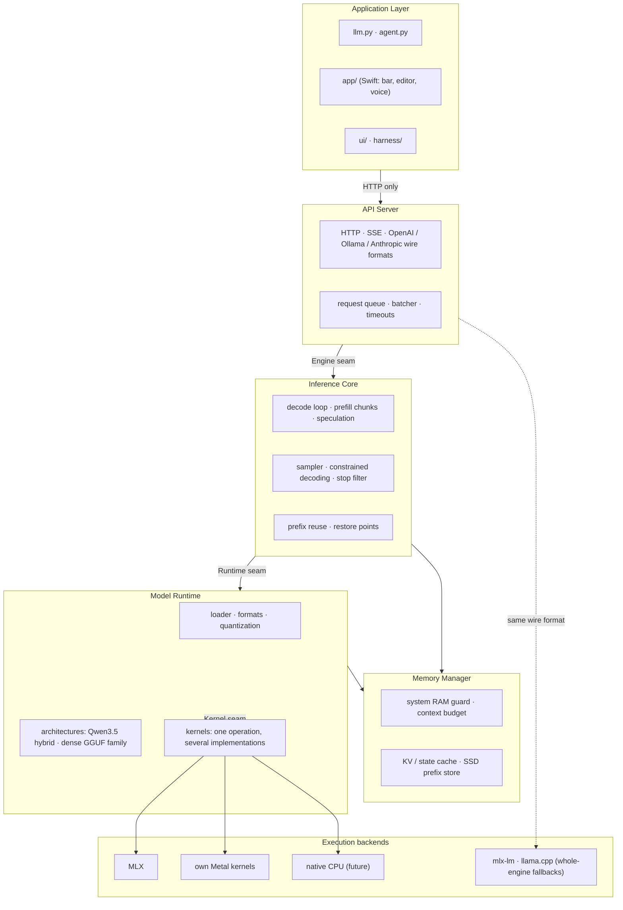
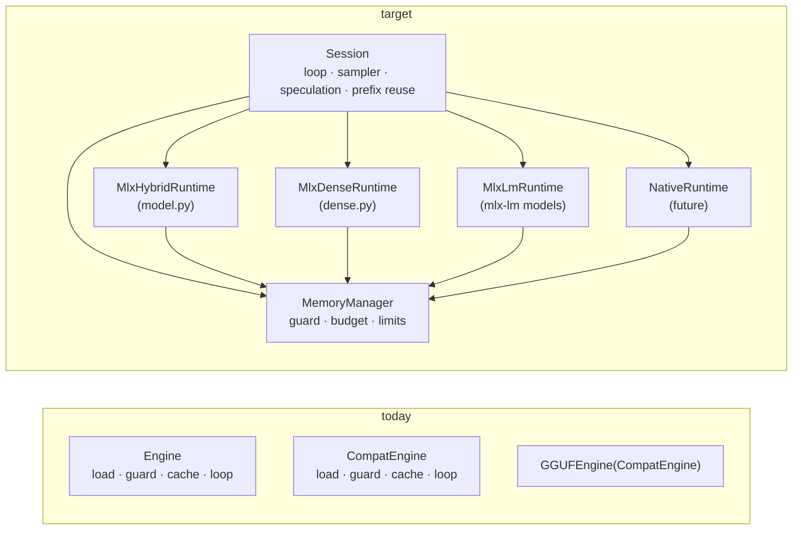

# Modular architecture

The target shape of the engine, the map from today's files onto it, and the order in which the
boundaries get drawn. Nothing here is a rewrite: each step moves existing, working code behind an
interface and is checked by the test suite and `./llm perf` before the next one starts.

Read ARCHITECTURE_REVIEW.md first — it is the evidence this design answers to.

## Components

### Dependency rules

Arrows point from the caller to what it may import. Everything else is forbidden, and the first three
rules are checkable with a grep in CI.

1. **The Application Layer talks to the engine over HTTP only.** It imports nothing from `engine/`
   that pulls in MLX. (Today: true for the Swift app and `agent.py`; `llm.py` imports
   `engine.gguf`, `engine.modelinfo`, `engine.preflight` — all stdlib-only, which is the rule's intent.)
2. **The API Server does not import an array library.** It sees token ids, strings and dicts.
3. **The Inference Core does not name a backend.** It calls the Runtime seam; `mx.` does not appear in it.
4. **The Memory Manager owns every number about memory** — the system guard, the context budget, bytes
   per cached token, wired and cache limits. Backends report; they do not decide.
5. **A kernel knows its operation and nothing else.** No model config, no cache class, no engine.
6. **Fallback engines are whole processes or whole classes**, never mixed into the native forward pass.

## Where today's files belong

| Component | Files today | MLX coupling | Boundary work |
|---|---|---|---|
| **Application Layer** | `llm.py` (4167 lines), `agent.py`, `ui/`, `harness/`, `app/` (Swift) | none | none — already over HTTP |
| **API Server** | `engine/server.py`, `anthropic.py`, `ollama.py`, `parsers.py`, `structured.py`, `stopfilter.py`, `logs.py`, `gguf_server.py` | 4 calls (memory counters in `/health`) | move the counters behind `ENGINE.memory_breakdown()`; declare the Engine protocol |
| **Inference Core** | `engine/generate.py` (`Engine.generate`, `Sampler`, `Drafter`, loop detectors), `batch.py`, `compat.py` (`CompatEngine.generate`) | heavy: 77 + 53 + 14 references | the largest piece of Phase 2 — see below |
| **Memory Manager** | `engine/memory.py` (system side, no MLX), guard methods inside `Engine` *and* `CompatEngine`, `prefix_store.py`, `KVCache`/`SSMCache` in `model.py`, a second `KVCache` in `dense.py` | cache classes are MLX arrays | one guard, one cache interface |
| **Model Runtime** | `engine/model.py`, `dense.py`, `gated_delta.py`, `ptq1.py`, `vision.py`, `loader.py`, `quant.py`, `convert.py`, `gguf*.py`, `tokenizer.py`, `family.py`, `steering.py`, `weightpatch.py`, `cluster.py` | by design | none: this *is* the MLX backend's home |
| **Kernels** | `engine/kernels/` (new), plus the kernels inside `gated_delta.py` and `ptq1.py` | Metal via `mx.fast.metal_kernel` | move the older kernels behind the registry when next touched |

## The Inference Core boundary, concretely

`Engine` in `generate.py` is one class doing four components' work: it loads the model (Runtime), runs
the guard (Memory), keeps the prefix cache (Memory), and drives the loop (Core). `CompatEngine`
repeats most of that for a different model source, and `GGUFEngine` inherits the repeat. The split:

`Session` is the present `Engine.generate` with its `mx.` calls replaced by the Runtime
methods of BACKEND_INTERFACE_SPEC.md §3. The MLX calls it makes today, and where each goes:

| Today in `Engine.generate` | Becomes |
|---|---|
| `self.model(ids, cache, pos, …)` | `runtime.forward(...)` |
| `mx.async_eval(y)` | `runtime.flush(y)` |
| `y.item()` | `runtime.read_token(y)` |
| `Sampler(...)(logits)` (argpartition, softmax, categorical on the GPU) | `runtime.sample(logits, state)`; the *policy* (temperature, top-k/p, penalties, the constraint hook) stays in the Core |
| `self.model.commit(cache, 1 + acc)` | `runtime.commit(cache, m)` |
| `c.snapshot()` / `c.restore()` / `c.trim_to()` | `runtime.snapshot / restore / truncate` |
| `mx.eval([... cache arrays ...])` | `runtime.flush(cache)` then wait |
| `mx.clear_cache()`, `mx.get_peak_memory()` | `memory.trim()`, `memory.report()` |

Three things deliberately stay where they are:

* **Sampling runs on the device.** Pulling 248 320 logits to the CPU each step costs more than the
  sampler; `sample` is a Runtime method for that reason, with the policy passed in.
* **Speculation's acceptance rule stays in the Core.** It is arithmetic on a handful of numbers per
  drafted token and defines the engine's exactness guarantee; it must not differ between runtimes.
* **Prompt building and tokenization stay with the model** (they are properties of the checkpoint),
  exposed through the Engine seam as now.

## Order of work

Each row is a commit-sized step with its own gate. None changes behaviour; the gate for all of them is
the full unit suite, the nine integration tests on a real model, and `./llm perf` within tolerance.

| # | Step | Touches | Extra gate |
|---|---|---|---|
| 1 | Kernel registry and its first operation | `engine/kernels/`, `model.py` (one branch) | **done** — `tests/test_kernels.py` |
| 2 | Declare the Engine protocol; make the server depend on it, not on three concrete classes | `server.py`, new `engine/protocol.py` | **done** — `tests/test_protocol.py`; it found that every chat on the GGUF and mlx-lm backends answered 500 |
| 3 | One memory guard: lift `_reserve` / `_check_memory` / `_fit_output` out of `Engine` and `CompatEngine` | `generate.py`, `compat.py`, `memory.py` | **done** — `memory.reserve / check / fit_output`; both engines call them |
| 4 | One cache interface (`append`, `truncate`, `snapshot`, `restore`, `nbytes`, `dtype`) over the two `KVCache` classes and `SSMCache` | `model.py`, `dense.py`, `batch.py`, `prefix_store.py` | **done** — `engine/cache.py`, one `KVCache`; every cache both engines keep is asserted float16 |
| 5 | Runtime seam for the native model: `MlxHybridRuntime` wraps `model.py`; `Engine.generate` calls it | `generate.py`, new `engine/session.py`, `engine/runtime.py` | **done** — 14 generation cases token-identical before and after (greedy, sampled, speculation, prefix reuse, stop strings, JSON, reasoning); decode step 5.14 → 5.20 ms; the loop also runs on a plain-Python runtime (`tests/test_session.py`) |
| 6 | Same for `dense.py` and mlx-lm, retiring the duplicated loop in `CompatEngine` | `compat.py`, `gguf_engine.py` | GGUF parity tests against llama.cpp unchanged |
| 7 | Move `gated_delta` and `ptq1` kernels behind the registry | `gated_delta.py`, `ptq1.py` | `bench_kernels` rows for each, equal to their current figures |

Steps 2 – 4 are independent of each other. Step 5 depends on 3 and 4. Step 6 depends on 5. A native
runtime (NATIVE_RUNTIME_MIGRATION_PLAN.md) depends on 5 and nothing later.

## What is deliberately not proposed

* **No tensor abstraction layer.** The Runtime seam is at the forward pass. A portable `Tensor` class
  under `model.py` would cost every operation an indirection to serve a backend that does not exist,
  and `mx.compile` — which removes a third of the decode step's kernel launches — only works on MLX
  arrays directly.
* **No package reshuffle up front.** Files move when the step that needs them moves them. Renaming
  `engine/` into five packages first would touch every import and every test for no measurable gain.
* **No plugin system for backends.** Four engines and a handful of kernels are a dictionary and an
  `if`. The registry in `engine/kernels/` is 90 lines and should stay near that.
* **No WebSocket endpoint yet.** Every client the engine serves (OpenAI, Ollama, Anthropic wire
  formats; the Swift app) streams over SSE. Add WebSockets when a client needs duplex traffic —
  barge-in for voice is the likely first case — not before.
