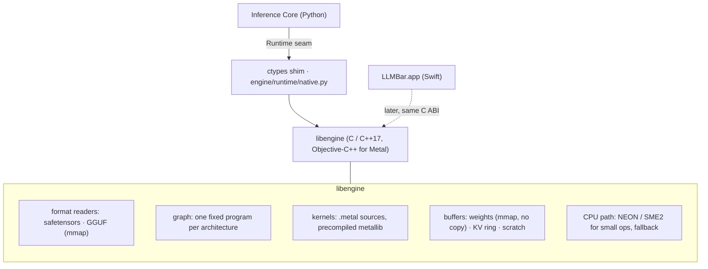

# Native runtime migration plan

How the engine gets from "MLX runs the model, with a few kernels of our own" to "a runtime of our own
runs the model, with MLX as an option" — subsystem by subsystem, each with the measurement that
justifies starting it and the measurement that lets it ship.

This is Stage 3 of RUNTIME_EVOLUTION_ROADMAP.md. It assumes the Runtime seam of
BACKEND_INTERFACE_SPEC.md §3 exists (MODULAR_ARCHITECTURE.md, step 5). **Nothing in this document is
started.** It is a plan, written so that Stage 1 and 2 work does not close doors on it.

## What "native" has to beat

A native runtime is not worth its maintenance for being native. On this hardware a decode step is
mostly a memory read, and no language reads memory faster than the bus. Measured on an M5 / 16 GB,
Qwen3.5-0.8B 4-bit, after the Stage 1 fixes of this audit:

| Part of a decode step (512-token context) | Time | Who can reduce it |
|---|---|---|
| Reading the weights at bus speed (115 GB/s measured) | 3.68 ms | nobody — fewer bytes per token only (quantization, sparsity) |
| GPU work above that floor | ~1.4 ms | fewer, larger kernels; better weight layouts |
| CPU / Python outside the forward pass | 0.07 ms | a C loop — worth at most this |

So the case for a native runtime is **not** decode speed on one model on one Mac. It is:

1. **Kernel count.** MLX runs the step as thousands of small dependent kernels; `mx.compile` fuses
   elementwise chains but cannot fuse across a matmul or a custom kernel. A runtime that owns the
   command buffer can encode a whole layer — or a whole step — once and replay it. This attacks the
   1.4 ms, and it is the only large item on the list.
2. **Memory ownership.** MLX's allocator and its buffer cache are opaque; the engine works around
   them (`set_cache_limit`, `clear_cache` at seven call sites, a wired limit it can only suggest
   raising). Owning the buffers means the KV cache can be a ring of pages the Memory Manager hands
   out, weights can be mapped rather than copied, and "how much is in use" is a fact, not an estimate.
3. **Start-up and footprint.** The venv is ~310 MB and importing MLX is most of the 0.5 s cold start.
   A native core in the app bundle removes both for the models it supports.
4. **Independence.** A change in MLX's promotion rules cost this engine half its long-context speed
   without any test noticing (see the review). Fewer such surfaces is worth something by itself.

If, when the seam exists, a prototype of (1) does not show the 1.4 ms shrinking, Stage 3 stops there
and the engine stays MLX + own kernels. That is an acceptable outcome and the plan is built to find
out cheaply.

## Shape

Decisions, and why:

* **C ABI, C++17 inside, Objective-C++ only at the Metal boundary.** The ABI is what Python (ctypes),
  Swift and tests bind to; it must be plain C. Swift is not the implementation language: the Python
  engine has to call the same code, and a Swift core would need a C shim anyway.
* **A fixed program per architecture, not a graph compiler.** The engine runs two architecture
  families (Qwen3.5 hybrid; the dense GGUF family, parameterised by `dense.Config`). Each is a known
  sequence of a dozen kernel kinds. Encoding that sequence directly is a few hundred lines; a general
  graph IR is a project. Add the IR if a third family arrives that the two programs cannot express.
* **Kernels are the ones Stage 2 already wrote.** `mx.fast.metal_kernel` bodies are Metal Shading
  Language; the same source compiles into a metallib. Stage 2 is therefore not thrown away — it is
  the kernel library of Stage 3, already benchmarked.
* **Python stays the Inference Core.** At 1.3 % of the step there is nothing to win by moving the loop,
  and the loop (speculation, constrained decoding, think budgets, stop strings) is where behaviour
  changes most often. It moves to C only if the app needs to run without a Python process at all.

## Order of migration

Each subsystem replaces one MLX dependency behind the seam, keeps the MLX implementation selectable,
and has an entry gate (why start) and an exit gate (when it may be the default).

| # | Subsystem | Replaces | Entry gate | Exit gate |
|---|---|---|---|---|
| N0 | **Seam + ctypes shim + CI build** of an empty `libengine` | — | MODULAR step 5 done | library builds in `build-app.sh`; `--runtime mlx` unchanged |
| N1 | **Weight store**: mmap safetensors / GGUF, hand buffers to Metal without a copy | `mx.load`, loader's repacking | load time or peak-while-loading is a complaint, *or* N3 needs it | bytes identical to the MLX loader's arrays for every tensor of three checkpoints; load ≤ today's |
| N2 | **KV / state cache** owned by the runtime: paged ring, float16, exact byte accounting | `KVCache` / `SSMCache` as MLX arrays | MODULAR step 4 done | prefix-reuse bit-exactness test; `/health` bytes equal the allocator's count; SSD store round-trip |
| N3 | **Decode step for the dense family** as one encoded command buffer | MLX graph for `dense.py`, decode only | Stage 2 has a quantized-GEMV kernel at ≥ parity with MLX | greedy text equal to the MLX path on the GGUF parity set; decode step ≥ 10 % faster at 512 and 8K; prefill still on MLX |
| N4 | **Decode step for the Qwen3.5 hybrid** (adds Hadamard, gated-delta, fused projections) | MLX graph for `model.py`, decode only | N3 shipped | same gate on the three README models; speculation's verify path still exact |
| N5 | **Prefill** (GEMM, causal attention, chunking) | MLX for multi-token passes | a GEMM of ours within 10 % of MLX's (12.3 TFLOP/s fp16 on the M5) — the hardest kernel on the list | prefill tok/s ≥ MLX at 128 / 1K / 4K; peak memory ≤ today's |
| N6 | **Vision tower, embeddings, batched decode** | remaining MLX users | demand | parity tests per feature |
| N7 | **MLX optional**: the engine starts and serves a supported model with `mlx` not importable | the import itself | N4 + N5 | test suite passes in a venv without MLX for supported models; unsupported ones name MLX as the missing piece |

N3 before N4 because the dense family is the simpler program (no recurrent state, no Hadamard) and
the one with an external oracle: llama.cpp's output on the same file.

N5 is where the plan is most likely to stop. Prefill is compute-bound, MLX's GEMM is Apple's own and
close to the hardware ceiling, and "MLX for prefill, native for decode" is a perfectly good permanent
state. N7 is then simply never reached, and that is fine.

## Hybrid CPU / GPU execution

Unified memory means the CPU and GPU share one bus: running both on the weights at once splits the
bandwidth rather than adding to it, so the naive "use the CPU too" gains nothing for decode. Where the
CPU can help, in the order worth testing:

1. **Small operations between large kernels** (norms on a 1 024-wide vector, the sampler's top-k on a
   pre-filtered set). A GPU kernel launch costs more than these take on a P-core. Needs zero-copy
   shared buffers and a way to interleave without a synchronisation per step — which is exactly what
   owning the command buffer provides. Cannot be evaluated before N3.
2. **SME2 for the tail of prefill** and for models too small to fill the GPU. The M5 reports
   `FEAT_SME` and `FEAT_SME2`. For GEMM this is settled against the CPU (RUNTIME_EVOLUTION_ROADMAP.md, "CPU: SME2 and C": the
   GPU is 4.7 – 6.2× faster than Accelerate at prefill shapes). What is not measured is a single-row
   GEMV on sub-1B models, where launch overhead dominates and the CPU is plausible competition. Test: a standalone SME2 4-bit GEMV against
   MLX's on the 0.8B's matrices. Cost of the test: a day. Not started.
3. **Tokenization, JSON grammar, HTTP** already run on the CPU and overlap the GPU; nothing to move.

## Risks

| Risk | Likelihood | Effect | Containment |
|---|---|---|---|
| A native decode step is not faster: MLX is already near the floor | medium | Stage 3 has no performance case | N3's exit gate is a number; stop there and keep Stage 2's kernels |
| Numerics drift from MLX (accumulation order, float16 vs float32 intermediates) | high | different text; speculation's exactness claim broken if the verify path and the decode path differ | parity tests on logits with stated tolerances; decode and verify must run on the *same* runtime, never mixed |
| Two runtimes to maintain for every model feature | certain | each new architecture costs twice | native supports a declared subset; everything else is `Unsupported` → MLX. Never promise parity of coverage |
| Metal behaviour differs across Apple GPU generations (threadgroup memory limits, fast-math defaults) | medium | a kernel that is correct on the M5 fails on an M1 | `available()` builds the kernel on the user's device; CI on the oldest supported chip, or a self-test at first start |
| Memory accounting diverges between the engine's guard and the runtime's allocator | medium | the RAM guard — the product's headline feature — misjudges | one owner (Memory Manager); the runtime reports, never estimates; `/health` shows both figures until they are proven equal |
| Build and signing complexity (a dylib inside a notarized app, a metallib, CI for C++) | certain | slower releases | N0 exists only to pay this cost once, before any feature depends on it |
| MLX changes under us while both paths exist | medium | the reference moves | pin the MLX version; `tests/perf.py` baseline per version |

## Rollback

Every N-step ships behind `--runtime`, default `mlx`, until its exit gate passes on three machines
(16 GB fanless, 32 GB+, and the oldest supported chip). Flipping the default is a one-line change and
its own release. A regression after the flip is fixed by flipping it back, not by a hotfix to the
runtime — the MLX path is kept green by the same suite for as long as it is selectable.
