# Runtime evolution roadmap

    MLX-first  →  MLX + own Metal kernels  →  hybrid runtime  →  independent native runtime

Three stages, each with the measurements that open and close it. The rule that orders everything
below: **a change is scheduled by the time it can remove, measured, not by how native it is.**

Reference machine for every figure: Apple M5, 16 GB, macOS 26.4.1, MLX 0.32.3, Qwen3.5-0.8B 4-bit
(mlx-community) unless another model is named. Method and raw numbers: ARCHITECTURE_REVIEW.md.

## Where a decode step goes today

After the Stage 1 fixes made during this audit (cool machine; a warm fanless Air is ~1.7× slower across the board):

| Context | Step | Weights + cache read | Effective rate | Share of the 115 GB/s bus |
|---|---|---|---|---|
| 512 | 5.18 ms | 0.43 GB | 83 GB/s | 72 % |
| 8 192 | 6.15 ms | 0.52 GB | 85 GB/s | 74 % |
| 32 768 | 9.35 ms | 0.82 GB | 88 GB/s | 77 % |

and split by who is responsible, at 512 tokens:

| | Time | Share |
|---|---|---|
| Reading the weights at bus speed | 3.68 ms | 71 % |
| GPU work above that floor | ~1.4 ms | 27 % |
| Python and CPU outside the forward pass | 0.07 ms | 1.3 % |

Everything in Stage 2 and 3 competes for the middle row. The bottom row is why **rewriting the decode
loop in C is not on this roadmap**: it could return 0.07 ms of 5.2.

## Stage 1 — optimized MLX-first engine

Keep MLX as the only tensor backend; fix what the engine does around it; draw the module boundaries.

### Done in this audit

| Change | Effect (decode step) | Where |
|---|---|---|
| V enters the KV cache as float16 (it was float32 on every checkpoint with bfloat16 scales) | 8K: 12.8 → 7.4 ms · 32K: 25.4 → 14.4 ms · KV cache −33 % | `engine/model.py`, `attn_pre` |
| bfloat16 scales / biases / norm weights converted to float16 at load, so quantized matmuls stop promoting to float32 | on top of the first: 512: 6.4 → 5.2 ms · 8K: 7.4 → 6.2 ms · 32K: 14.4 → 9.4 ms | `engine/loader.py` |
| Both together | **×1.27 at 512 · ×2.08 at 8K · ×2.72 at 32K** (×1.5 / ×2.9 / ×2.3 when measured alternately on a warm machine), greedy text unchanged | |
| Restored SSD prefix entries are float16 whatever they were written as | old entries do not bring the slow path back | `engine/prefix_store.py` |
| Kernel registry, first operation, benchmark and tests | the seam Stage 2 plugs into | `engine/kernels/`, `tests/bench_kernels.py`, `tests/test_kernels.py` |

### Remaining

| # | Item | Why | Milestone |
|---|---|---|---|
| 1.1 | ✅ done · **A dtype guard in the suite**: every array a forward pass keeps (KV, recurrent state, logits) has the dtype its budget assumes | the defect above lived through 1 100 tests because none looked | one test per engine class; fails on a float32 cache |
| 1.2 | **Re-measure the published figures** (README "Why", `tests/perf_baseline.json`) on the 0.8B / 2B / 4B set | they predate the fix; the long-context table is now pessimistic by 2 – 2.7× | new baseline saved; README table and `docs/` updated in one pass |
| 1.3 | **Same audit for the GGUF decoder** (`dense.py`): which arrays are float32 by intent (the residual stream, per its docstring) and which by accident | the same class of defect, different file | a table of dtypes per stage in the review; fixes only where measured |
| 1.4 | ✅ done · **Declare the Engine protocol; one memory guard; one cache interface** | MODULAR_ARCHITECTURE.md steps 2 – 4 | each lands with the suite green and `./llm perf` within tolerance |
| 1.5 | ✅ done · **Runtime seam for the native model** | MODULAR step 5; unblocks Stage 3 | greedy output identical; decode step within 1 % |
| 1.6 | **Continuous batching**: admit a request into a running batch instead of only at its start | today `batch.py` batches requests that arrive inside one window; a late one waits for the batch to finish | time-to-first-token for a request arriving mid-batch ≤ 2 decode steps + its own prefill |
| 1.7 | **Prefill profile** by the method of `tests/layer_profile.py` (truncated forward, one eval) | prefill has no per-layer profile; "compute-bound" is asserted from one matmul benchmark | per-layer table at 1K and 4K; the share of time in GEMM named |
| 1.8 | **Embedding under memory pressure keeps the conversation's restore points** | `_reserve` gives up snapshots first, and `embed` calls it — above the RAM limit an embedding request silently costs the next chat its prefix (seen as a test that fails only on a loaded machine) | `test_embeddings_leave_the_conversation_cache_alone` passes with the machine above the limit, or the trade is documented as intended |
| 1.9 | **Streamed MoE experts on a real oversized model** — the MLX route (`engine/moe_stream.py`) is measured on real OLMoE-1B-7B (`tests/bench_moe.py`: 15 – 18 tok/s with half the experts resident against 108 – 126 with all, identical tokens); the GGUF route (`dense.StreamedExperts`) was re-checked against the eager path and fixed (grouped kernel), but has still not been run on a real GGUF too large to hold | what remains is a model that does not fit this Mac at all, where hit rate decides the speed | load time, peak memory and decode tok/s on one real MoE too big for 16 GB, with prefetch of the next layer's experts tried as the first speed-up |

**Exit:** 1.1 – 1.5 done. Stage 2 work may start before that — it needs only the kernel seam, which exists.

## Stage 2 — own Metal kernels, selectively

One operation at a time, behind `engine/kernels`, each benchmarked against MLX by
`tests/bench_kernels.py`, default only when it wins.

### Candidates, ranked by measured headroom

| # | Operation | Headroom | Evidence | Verdict |
|---|---|---|---|---|
| 2.1 | **Fused layer tail**: the elementwise chain between matmuls (norm → Hadamard → cast; SwiGLU → Hadamard; gate · sigmoid → residual add) as one kernel per block | part of the ~1.4 ms above the floor; these chains are what `mx.compile` already fuses, but it cannot fuse across the matmul or the gated-delta kernel | `tests/profile.py`: 27 % of the step is not weight reading | **next** — first measure launch count per step with Metal's own counters, then the cheapest block |
| 2.2 | **4-bit affine GEMV on a tiled weight layout** | the PTQ1 kernel gained 10 – 20 % over MLX's 2-bit GEMV from layout alone (`engine/ptq1.py` header) | measured on a different quantization; unproven for 4-bit | **investigate** — a one-matrix benchmark first (lm-head: 248 320 × 1 024), DRAM-sized, before any integration |
| 2.3 | **Decode attention with the cache write and RoPE folded in** | small: after the dtype fix the reference reads the cache at ~99 GB/s | `bench_kernels`: the standalone Metal kernel is 0.89 – 1.03× MLX | **parked** — kernel exists, off by default; revisit only as part of 2.1's "one kernel per layer" |
| 2.4 | **FlashAttention-style prefill attention** (tiled, online softmax) | unknown until 1.7 | — | **blocked on 1.7** |
| 2.5 | **Prefill GEMM** | low: MLX's fp16 GEMM is Apple's, at 12.3 TFLOP/s here | README ceiling table | **not planned** — a Stage 3 item only if N5 is ever reached |
| 2.6 | **Quantized GEMM for 2 – 16 rows** (speculative verify) | verifying 16 drafted tokens costs ~2.1 – 2.6 decode steps on affine models, ~6 on ternary | `perf_baseline.json`: `verify16_cost` | **investigate after 2.2** — same kernel family |
| 2.7 | **KV cache quantization** (8-bit keys/values) | halves the cache read: at 32K the cache is ~48 % of the bytes read per step | arithmetic from the table above; quality cost unmeasured | **investigate** — needs `./llm eval`, not only speed |

### What a candidate must show to become a default

1. A `bench_kernels` row, DRAM-sized, interleaved, median of ≥ 20 rounds, on two machines.
2. **≥ 5 % on the whole decode step** in `./llm perf`, not only in isolation. (The attention kernel is
   the cautionary case: sound in isolation, and the operation turned out not to be the bottleneck.)
3. Parity test with a stated tolerance, and — if speculation is on — the verify path and the decode
   path produce the same greedy text with it enabled.
4. `./llm eval` unchanged within noise.

### Milestones

| | Measure | Target |
|---|---|---|
| M2.a | kernel launches per decode step, counted | a number, and the list of the ten most frequent |
| M2.b | GPU time above the weight-read floor, 0.8B at 512 | 1.4 ms → ≤ 1.0 ms |
| M2.c | share of the bus at 512 | 72 % → ≥ 80 % |
| M2.d | `verify16_cost` on affine 4-bit | ≤ 2.0 steps |

**Exit:** M2.b and M2.c met, or two consecutive candidates fail rule 2 — in which case the remaining
gap is not reachable kernel by kernel, and the question moves to Stage 3's "one command buffer per step".

## Stage 3 — hybrid, then independent native runtime

NATIVE_RUNTIME_MIGRATION_PLAN.md, steps N0 – N7. In roadmap terms:

| Phase | Content | Opens when | Closes when |
|---|---|---|---|
| **Hybrid** | N0 – N4: a native library runs the *decode step* for supported models; MLX runs prefill, vision and everything unsupported | Stage 1 item 1.5 done; Stage 2 has a quantized GEMV at ≥ parity | decode ≥ 10 % faster than the MLX path at 512 and 8K, text identical |
| **Independent** | N5 – N7: prefill native, MLX no longer imported for supported models | a GEMM of ours within 10 % of MLX's | suite green without MLX installed, for the declared subset |

"Hybrid" may be the permanent state. The plan says so explicitly and nothing depends on reaching the end.

## CPU: SME2 and C

The M5 reports `FEAT_SME` and `FEAT_SME2`. For matrix-matrix products the question is already answered,
and against the CPU. Measured on this machine: Accelerate's `cblas_sgemm` (fp32; Apple's own BLAS, taken as
a realistic upper bound on what hand-written SME2 could add) against MLX's GPU matmul (fp16), same shapes:

| Shape (M × K × N) | CPU, Accelerate | GPU, MLX | GPU faster by |
|---|---|---|---|
| 128 × 4096 × 4096 | 938 GFLOP/s | 5 629 GFLOP/s | ×6.0 |
| 1024 × 4096 × 4096 | 1 908 GFLOP/s | 8 932 GFLOP/s | ×4.7 |
| 4096 × 4096 × 4096 | 2 062 GFLOP/s | 12 286 GFLOP/s | ×6.0 |
| 1024 × 4096 × 11008 | 1 958 GFLOP/s | 12 141 GFLOP/s | ×6.2 |

Two verdicts follow, and both stand until a different bottleneck is measured:

* **SME2 for prefill: no.** Hand-written kernels would have to beat Apple's BLAS by the same 5 – 6× only to
  tie the GPU.
* **A CPU + GPU split of one matmul: no.** With the CPU at a fifth of the GPU's throughput, giving it a
  share adds at most 14 – 18 % in total, before the cost of synchronising two devices that also compete for
  the same memory bandwidth.

Two bounded experiments remain, neither started:

| Experiment | Question | Cost | Go / no-go |
|---|---|---|---|
| SME2 4-bit GEMV on one P-core vs MLX on the GPU, 0.8B matrices | is the CPU competitive on sub-1B models, where kernel launch dominates? (The one shape the table above does not cover: a single row.) | ~1 day, standalone C file | CPU ≥ 0.8× GPU on a 1 024-wide layer → design a mixed path; else close |
| Constrained decoding (`structured.py`) per-token cost | the JSON grammar checks candidate tokens in Python each step — is it visible in decode tok/s with `response_format` on? | an hour with `tests/profile.py` and a schema | > 10 % of the step → move the cursor to C; else leave |

C is the right tool for the second if it measures up, and for `libengine` in Stage 3. It is not a tool
for the bandwidth-bound part: the bus does not care what language asked.

## Sequence

```mermaid
gantt
    dateFormat X
    axisFormat %s
    section Stage 1
    dtype fixes, kernel seam (done)       :done, 0, 1
    1.1 dtype guard · 1.2 re-measure      :1, 2
    1.3 GGUF dtype audit · 1.7 prefill profile :1, 3
    1.4 protocol · guard · cache          :2, 4
    1.5 runtime seam                      :4, 6
    1.6 continuous batching               :4, 6
    section Stage 2
    2.1 launch count, fused layer tail    :2, 5
    2.2 tiled 4-bit GEMV (benchmark first):3, 5
    2.6 small-row GEMM · 2.7 KV 8-bit     :5, 7
    section Stage 3
    N0 shim and build                     :6, 7
    N1–N4 hybrid decode                   :7, 11
    N5–N7 independent (conditional)       :11, 14
```

The axis is order and rough relative size, not dates.
